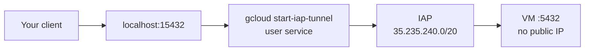
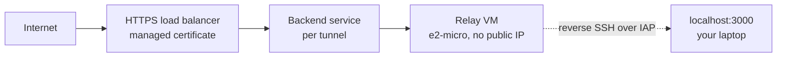

<p align="center">
  
</p>

<p align="center">
  <a href="CHANGELOG.md"></a>
  <a href="https://www.rust-lang.org"></a>
  <a href="Cargo.toml"></a>
  <a href="SECURITY.md"></a>
  <a href="LICENSE"></a>
  
</p>

<p align="center">
  <sub>Every push runs <a href=".github/workflows/ci.yml">CI</a>: rustfmt, clippy with <code>-D warnings</code>, the test suite, <code>cargo audit --deny warnings</code>, a build on the declared 1.88 floor, and zizmor over the workflows.</sub>
</p>


A TUI-first manager for GCP Identity-Aware Proxy tunnels. One binary, two modes:
a private port on `localhost` that reaches a VM inside a VPC, and a public HTTPS
URL in front of a service running on your laptop.

No inbound firewall rules, no public IP on the target, no agent on the VM.

## Features

| Feature | What it does |
|---|---|
| Access tunnels | `localhost:15432` reaches a VM port through IAP. Creates nothing in GCP |
| Jump tunnels | `--via <instance>` reaches a host only that instance can reach, such as a private GKE control plane |
| Public tunnels | `https://api.example.com` reaches `localhost:3000` through a relay VM and a global HTTPS load balancer |
| TUI dashboard | Live status, latency, connection counts, load-balancer traffic and per-tunnel logs |
| Managed services | launchd on macOS, systemd `--user` on Linux. Restart on failure, optional auto-start at login |
| Ephemeral runs | `gtunnel run` holds a tunnel in the foreground and tears its route down on exit, including on Ctrl+C |
| Multiple accounts | One gcloud configuration, project and zone per account; `;` cycles them in the TUI |
| Unmanaged discovery | `gcloud start-iap-tunnel` processes started outside gtunnel are listed, named for the target they hold, and read-only: every action on them is refused |
| Health and alerts | Health checks every 30s; a tunnel going unhealthy raises a system notification |
| Doctor | Reports leftovers, missing firewall rules and broken credentials, and removes what is safe to remove |
| Self-update | `gtunnel update` verifies the published SHA-256 before replacing the binary |

## How it works

Access mode forwards a local port to a port inside the VPC. IAP already accepts the
connection, so nothing is created:



Public mode holds a reverse SSH tunnel from a relay VM back to your laptop. A global
HTTPS load balancer terminates TLS and routes each hostname to that tunnel's relay port:



[docs/architecture.md](docs/architecture.md) has the full topology, every resource name
and the process model.

## Prerequisites

| Requirement | Notes |
|---|---|
| macOS or Linux | The service backend is launchd or systemd `--user` |
| Google Cloud SDK on `PATH` | gtunnel stores no credential; every token comes from `gcloud auth print-access-token` |
| An authenticated gcloud configuration | `gcloud auth login`, then `gtunnel init` |
| `roles/iap.tunnelResourceAccessor` | On the instance, destination group or project |
| A firewall rule allowing `35.235.240.0/20` | To the port you are tunnelling to. `gtunnel doctor` prints the exact command |

Public mode additionally needs a Cloud DNS managed zone and the IAM in
[docs/troubleshooting.md](docs/troubleshooting.md#iam).

## Installation

| Method | Command |
|---|---|
| From source | `cargo install --path .` |
| Release binary | Download `gtunnel-<target>.tar.gz` from Releases, verify the `.sha256`, extract |

Targets published per release: `aarch64-apple-darwin`, `x86_64-apple-darwin`,
`x86_64-unknown-linux-musl`, `aarch64-unknown-linux-musl`.

`gtunnel update` replaces a downloaded binary in place and verifies the published
SHA-256 first. An install from Homebrew or cargo is detected and the right upgrade
command is printed instead.

## Quick start

### A private port to a VM

```
gtunnel init                    # read a gcloud configuration into a gtunnel account
gtunnel add db my-vm:5432 -s    # localhost:15432 -> my-vm:5432, started now
psql -h localhost -p 15432
```

The add, start, stop and delete cycle, recorded against a throwaway account:


### A public URL to a local service

The relay is a one-off per account:

```
gtunnel domains add my-dns-zone  # register a Cloud DNS managed zone
gtunnel relay up                 # relay VM, load balancer, certificate
gtunnel expose web 3000 -s       # https://web.example.com -> localhost:3000
```

`gtunnel relay up` creates an e2-micro VM, a global load balancer and a managed
certificate: roughly USD 25/month per account, and nothing per tunnel.
`gtunnel relay down` removes all of it.

## TUI dashboard

`gtunnel` with no subcommand opens the TUI. `gtunnel demo` opens it filled with
synthetic data and touches no GCP project and no config file.

The header is the mark, the platform and product beside it, and the active account
over its GCP project id at the right edge, so the project a key is about to act on
is never off screen. `;` switches both together.

The list is a table with a `NAME  MODE  URL` header and fixed cells for the
auto-start and health flags. It hides a name suffix equal to the tunnel's own
account, so `k8s-dev` under `dev` reads `k8s`; Details prints the full stored name,
and every command still takes it. Every pane follows the terminal: below 100
columns the list stacks above Details, Logs and Metrics instead of sharing a row
with them, Logs keeps a minimum height so it survives a 24-row window, and a
Details value too long for its row wraps under its label.

`?` opens all 23 bindings as a page, in these four groups:

| Group | Keys |
|---|---|
| Tunnel | `s` start, `S` stop, `R` restart (rewrites the service), `A` toggle auto-start at login, `h` force a health check now |
| The list | `a` add, `e` edit the selected one, `d` delete, `m` import an ephemeral run as managed, `up`/`k` and `down`/`j` move the selection |
| This tunnel's URL and log | `c` copy the URL, `o` open it in a browser, `L` clear this tunnel's log, `r` refresh the list, metrics and health |
| The program | `;` cycle accounts, `?` this page, `q` quit, `Esc` close a page or cancel a prompt, `Ctrl+Z` suspend to the shell, `Ctrl+C` quit from anywhere |

The footer shows at most eight of them, chosen for the selected tunnel, so it never
carries both halves of the three case-sensitive pairs: `s`/`S` start and stop,
`a`/`A` add and auto-start, `r`/`R` refresh and restart. The keymap page is where
that difference is stated.

Metrics refresh every 5s, health every 30s, load-balancer request counts every 60s
over a 10-minute window.

## CLI commands

| Command | Purpose | Touches GCP |
|---|---|---|
| `init` | Import a gcloud configuration as a gtunnel account | read |
| `add` | Add a persistent Access tunnel | read |
| `expose` | Publish a local service at `https://<name>.<domain>` | write |
| `run` | Ephemeral tunnel in the foreground, gone on Ctrl+C | read, or write with `--public` |
| `start` / `stop` / `restart` | Service control | write, for a public tunnel only |
| `logs` | Read a tunnel's log, `-f` to follow | no |
| `list` | Every tunnel, managed or not | no |
| `delete` | Remove a tunnel and its route | write for public tunnels |
| `zones` / `domains` | Defaults for new tunnels | read |
| `relay up` / `down` / `status` | The shared relay for an account | write |
| `account` | List, select and remove accounts | no |
| `doctor` | Report, and with `--fix` remove, leftovers | read, write with `--fix` |
| `reset` | Remove all local configuration | no |
| `demo` | TUI with synthetic data | no |
| `update` | Check for and install a new version | no |

`--account <name>` works on every command and overrides the default account.
[docs/usage.md](docs/usage.md) documents each one with its real output.

## Configuration

| Path | Contents |
|---|---|
| `<config>/config.toml` | Accounts, default account, relay and domains per account |
| `<config>/tunnels.toml` | Persistent tunnels |
| `<config>/run/*.json` | One record per live `gtunnel run` |
| `<config>/logs/*.log` | Per-tunnel log, written by the service |

`<config>` is `~/Library/Application Support/gtunnel` on macOS and `~/.config/gtunnel`
on Linux. `GTUNNEL_CONFIG_DIR` overrides it.

Local ports are allocated from 15000-15999 and derived from the tunnel name, so the
same name gets the same port on every machine unless it is taken. Relay ports come
from 30000-30998.

## Troubleshooting

Start with `gtunnel doctor`. It reports everything it can detect and prints the exact
command for what it cannot fix itself.

| Symptom | Cause | Fix |
|---|---|---|
| `4003` in the log | IAP cannot reach the target port | Allow `35.235.240.0/20` to that port |
| `4033` in the log | Not authorized to tunnel through IAP | Grant `roles/iap.tunnelResourceAccessor` |
| A public tunnel returns 502 | The load balancer's health check cannot reach the relay port | Check the `gt-<acct>-lb-hc` firewall rule |
| A public tunnel returns 503 | Its backend, host rule or DNS record is missing | `gtunnel restart <name>` re-creates them |
| The tunnel is slow | gcloud's bundled Python has no NumPy | `gcloud components reinstall` |
| The service dies at every start | The unit does not carry gcloud's directory | `gtunnel restart <name>` rewrites it |

[docs/troubleshooting.md](docs/troubleshooting.md) has the full error table, the IAP
firewall and IAM requirements, the service commands for both platforms, and the cost
breakdown.

## Documentation

| Document | Contents |
|---|---|
| [docs/usage.md](docs/usage.md) | Every command, with its output |
| [docs/architecture.md](docs/architecture.md) | Topology, process model, resource names |
| [docs/troubleshooting.md](docs/troubleshooting.md) | Error table, firewall and IAM, services, cost |
| [CHANGELOG.md](CHANGELOG.md) | Release history |

The recordings above are generated from the committed
[VHS](https://github.com/charmbracelet/vhs) tapes in [docs/tapes](docs/tapes):

```
vhs docs/tapes/demo-tui.tape
vhs docs/tapes/demo-access.tape
```

## Safety

- `gtunnel doctor --fix` removes only resources tagged `gtunnel:<account>` that no live
  tunnel claims, and re-checks that claim immediately before each removal.
- A Cloud DNS record carries no description, so gtunnel treats one as its own only while
  it still holds a tagged backend, host rule or named port for the same tunnel.
- `gtunnel reset` removes local state only. Cloud resources go with `gtunnel relay down`.
- The self-updater verifies the published SHA-256 before it replaces anything.

## License

MIT. See [LICENSE](LICENSE).
