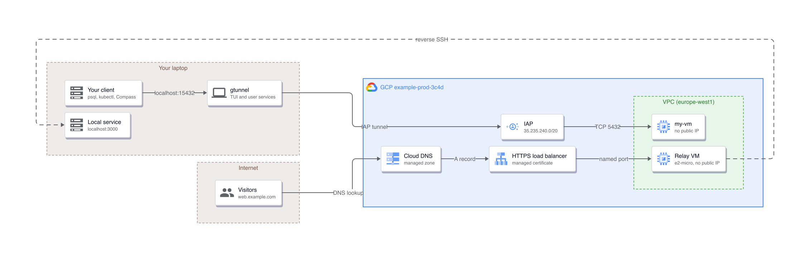

<p align="center">
  
</p>

<p align="center">
  <a href="https://gcheliz.github.io/gtunnel/"></a>
  <a href="https://github.com/gcheliz/gtunnel/releases/latest"></a>
  <a href="https://www.rust-lang.org"></a>
  <a href="Cargo.toml"></a>
  <a href="SECURITY.md"></a>
  <a href="LICENSE"></a>
  
</p>

## What gtunnel is

A TUI-first manager for GCP Identity-Aware Proxy tunnels, in one binary with two modes, each persistent or ephemeral ([Concepts](docs/usage.md#concepts)):

| Mode | You get |
|---|---|
| Access | A port on `localhost` that reaches a VM, or a host behind it, inside a VPC |
| Expose | An HTTPS URL in front of a service running on your laptop |

Tunnels are declared once, run as supervised user services, and are watched from a
dashboard that shows whether each one is carrying traffic.

<p align="center">
  
</p>

| Property | What it means in practice |
|---|---|
| Nothing is exposed | No inbound firewall rule, no public IP on the target, no agent on the VM. IAP authorises each connection against your own Google identity |
| Nothing is stored | gtunnel keeps no credential. Every token comes from `gcloud auth print-access-token` at connect time |
| Access mode creates nothing in GCP | A private port is a local process plus an IAP connection: no resource left behind, no cost |
| Tunnels survive the terminal | launchd on macOS, systemd `--user` on Linux: restart on failure, optional start at login, one log per tunnel |
| The dashboard tells the truth | Live latency, active connections, load-balancer request counts and the tunnel's own log, not merely a running process |



## Features

| Feature | What it does |
|---|---|
| Access tunnels | `localhost:15432` reaches a VM port through IAP. Creates nothing in GCP. Three target kinds: an instance, a host behind an instance with `--via <instance>` (a jump, such as a private GKE control plane), or an IAP destination group |
| Expose tunnels | `https://api.example.com` reaches `localhost:3000` through a relay VM and a global HTTPS load balancer |
| Gated URLs | `expose --private` turns on IAP for the tunnel's backend, so a visitor signs in with Google first. Listed as `gated` |
| Ephemeral tunnels | `gtunnel run` opens a tunnel in the foreground, optionally with `--ttl`; Ctrl+C closes it and leaves nothing behind |
| TUI dashboard | Live status, latency, connection counts, load-balancer traffic and per-tunnel logs |
| Managed services | launchd on macOS, systemd `--user` on Linux. Restart on failure, optional auto-start at login |
| Watchdog | `gtunnel watch install` restarts tunnels that are running but refusing connections |
| Multiple accounts | One gcloud configuration, project and zone per account; `;` cycles them in the TUI |
| MCP server and agent skill | `gtunnel mcp` is a stdio MCP server with 14 tools and 2 resources; `.agents/skills/gtunnel/SKILL.md` guides an agent through the CLI |
| `--json` output | `list`, `doctor` and `account list` print machine-readable JSON |
| Shell completions | `gtunnel completions <shell>` for bash, zsh or fish completes commands and tunnel names; install lines in [docs/commands.md](docs/commands.md#shell-completions) |
| Self-update | `gtunnel update` replaces the binary with the latest release; `--check` only reports. A Homebrew install is pointed at `brew upgrade` |

[docs/architecture.md](docs/architecture.md) has the topology for both modes, the jump and
service-lifecycle diagrams, the account model, and every resource name.

## Prerequisites

| Requirement | How to get it | How to check |
|---|---|---|
| macOS or Linux | — | `uname -s` |
| Google Cloud SDK on `PATH` | macOS: `brew install --cask gcloud-cli`. Linux: `curl https://sdk.cloud.google.com \| bash`, or your distribution's package ([install guide](https://cloud.google.com/sdk/docs/install)) | `gcloud version` |
| gcloud logged in as your own Google user account | `gcloud auth login you@example.com`, then `gcloud init` (or `gcloud config set project example-dev-1a2b`) for the configuration gtunnel will read | `gcloud auth list` marks the account active with `*`; `gcloud config list` shows the project |
| `roles/iap.tunnelResourceAccessor` | [Grant it](https://cloud.google.com/iap/docs/using-tcp-forwarding#grant-permission) on the instance, destination group or project | `gtunnel doctor` |
| A firewall rule for `35.235.240.0/20` | `gtunnel doctor` prints the exact `gcloud compute firewall-rules create` for the port you are tunnelling to | `gtunnel doctor` |
| Rust 1.89 or newer and a C compiler, for the cargo routes only | `curl --proto '=https' --tlsv1.2 -sSf https://sh.rustup.rs \| sh` ([rustup.rs](https://rustup.rs)); the compiler is `xcode-select --install` on macOS, `build-essential` or `gcc` on Linux ([building from source](docs/usage.md#building-from-source)) | `cargo --version`, `cc --version` |

gtunnel mints every token with `gcloud auth print-access-token` for the account's gcloud
configuration, so the login above is the only credential it uses. Expose mode also needs a
[Cloud DNS](https://cloud.google.com/dns/docs/zones) managed zone you control and the IAM in
[docs/troubleshooting.md](docs/troubleshooting.md#iam).

The guided walkthrough, from a clean machine to a first working tunnel with the output of
every step: [docs/usage.md](docs/usage.md#getting-set-up).

## Installation

| Route | Command | Upgrade with |
|---|---|---|
| A published binary | the five lines below | `gtunnel update` |
| From a clone | `cargo install --path .` | `gtunnel update`, or `git pull` and run it again |
| From the repository | `cargo install --git https://github.com/gcheliz/gtunnel` | `gtunnel update`, or the same command with `--force` |

| Machine | File |
|---|---|
| Apple Silicon Mac | `gtunnel-macos-arm64-v<version>.tar.gz` |
| Intel Mac | `gtunnel-macos-intel-v<version>.tar.gz` |
| Linux, amd64 | `gtunnel-linux-amd64-v<version>.tar.gz` |
| Linux, arm64 | `gtunnel-linux-arm64-v<version>.tar.gz` |

```
VERSION="v0.2.0"
F="gtunnel-macos-arm64-${VERSION}.tar.gz"
curl -fsSLO "https://github.com/gcheliz/gtunnel/releases/download/${VERSION}/$F"
curl -fsSLO "https://github.com/gcheliz/gtunnel/releases/download/${VERSION}/$F.sha256"
shasum -a 256 -c "$F.sha256" && tar -xzf "$F" && sudo mv gtunnel /usr/local/bin/
```

On Linux use `sha256sum -c` in place of `shasum -a 256 -c`. The Linux builds are static
musl binaries and do not depend on the host's glibc.

The checksum proves the download arrived intact. The
[attestation](https://docs.github.com/actions/security-guides/using-artifact-attestations-to-establish-provenance-for-builds)
proves this repository built it:

```
gh attestation verify "gtunnel-macos-arm64-${VERSION}.tar.gz" -o gcheliz
```

Silence and exit 0 mean it checked out; a file this repository did not build fails with
`HTTP 404`. `--format json` names the workflow, tag and commit that produced it
([docs/usage.md](docs/usage.md#4-install-gtunnel) shows that output). Attestations begin
with v0.1.1.

There is no `cargo install gtunnel`: the name on crates.io belongs to an unrelated crate.
[docs/troubleshooting.md](docs/troubleshooting.md#installation) says what it leaves behind.

`gtunnel update` verifies the published SHA-256 before replacing the binary. Confirm the
install with `gtunnel --version`, then run `gtunnel doctor` before the first tunnel.

## Quick start

### A private port to a VM

```
gtunnel init                                     # read a gcloud configuration into a gtunnel account
gtunnel add db my-vm:5432 --local-port 15432 -s  # localhost:15432 -> my-vm:5432, started now
psql -h localhost -p 15432
```

Without `--local-port` the port is derived from the tunnel name, in 15000-15999.

<p align="center">
  
</p>

### A public URL to a local service

```
gtunnel relay up --managed-zone my-dns-zone  # once per account: relay VM, load balancer, certificate
gtunnel expose web 3000 -s                   # https://web.example.com -> localhost:3000
```

The relay costs roughly USD 25/month per account and nothing per tunnel; `relay down`
removes all of it. `gtunnel domains add <zone>` registers further managed zones once the
relay exists.

## The TUI

`gtunnel` with no subcommand opens it; `gtunnel demo` opens it on synthetic data, touching
no GCP project and no config file.

| Key | Does |
|---|---|
| `?` | All 32 bindings as a page |
| `;` | Switch account and project together |
| `:` | The accounts page: add, edit, select and remove accounts |
| `e` | Edit the target and ports, rename, or move the tunnel to another account |

The footer offers only what the selected tunnel can do. Metrics refresh every 5s, health
every 5s, load-balancer request counts every 60s. Below 121 columns the list stacks above
Details, Logs and Metrics.

Every binding and pane: [docs/usage.md](docs/usage.md#the-tui). Why each looks the way it
does: [docs/design.md](docs/design.md).

## Commands

| Command | Does |
|---|---|
| `gtunnel` | Opens the TUI |
| `gtunnel init` | Sets up a gtunnel account from a gcloud configuration |
| `gtunnel add` | Adds a persistent Access tunnel |
| `gtunnel expose` | Publishes a local service at `https://<name>.<domain>` via the relay |
| `gtunnel run` | Runs an ephemeral tunnel in the foreground |
| `gtunnel start`, `stop`, `restart` | Controls a tunnel's service |
| `gtunnel autostart` | Shows or sets whether a tunnel starts at login |
| `gtunnel list` | Lists every tunnel |
| `gtunnel logs` | Shows the log of a tunnel or a live run; `-f` follows it |
| `gtunnel delete`, `rename`, `move` | Removes, renames, or moves a tunnel to another account, with its service and log |
| `gtunnel zones`, `domains` | Compute zones and Expose domains for the account |
| `gtunnel relay` | The account's shared relay (`up`, `down`, `status`) |
| `gtunnel account` | Accounts (`list`, `select` or its alias `default`, `add`, `edit`, `remove`) |
| `gtunnel watch` | Restarts tunnels that are running but refusing connections; `install` makes it a background agent |
| `gtunnel doctor` | Reports leftovers and misconfiguration; `--fix` removes what is gtunnel's |
| `gtunnel reset` | Removes all local configuration, never anything in GCP |
| `gtunnel update` | Checks for and installs updates |
| `gtunnel demo` | Opens the TUI with synthetic data |
| `gtunnel mcp` | Runs the MCP stdio server |
| `gtunnel completions` | Prints a completion script for bash, zsh or fish |

Every command accepts `--account <name>` and `--log-level <level>`. The full command map,
with every flag and its output: [docs/commands.md](docs/commands.md).

## AI agents and MCP

| Piece | What it gives an agent |
|---|---|
| `.agents/skills/gtunnel/SKILL.md` | A guide in the open Agent Skills format: tunnel naming, target routing through a bastion, account scoping, and the checks to run before reporting a tunnel works |
| `gtunnel mcp` | A JSON-RPC 2.0 stdio server in the binary: 14 tools and 2 resources (`gtunnel://tunnels`, `gtunnel://accounts`), protocol revision 2026-07-28 served statelessly, and 2025-11-25, 2025-06-18 and 2024-11-05 through `initialize`, with titles, read-only and destructive annotations, and a schema-checked `structuredContent` on the six JSON tools |
| `gtunnel mcp --validate` | Validates every tool schema and exits non-zero on a bad one. `npx @modelcontextprotocol/inspector gtunnel mcp` inspects them interactively |

A `.mcp.json` in the workspace root registers the server:

```json
{
  "mcpServers": {
    "gtunnel": {
      "command": "gtunnel",
      "args": ["mcp"]
    }
  }
}
```

| Client | Where the entry goes |
|---|---|
| Claude Code | `.mcp.json` in the project, read at startup |
| Gemini CLI | `"mcpServers"` in `.gemini/settings.json` |
| Claude Desktop | `~/Library/Application Support/Claude/claude_desktop_config.json` |

## Configuration

Everything lives in `~/.gtunnel`: `config.toml` (accounts, projects, zones, relay),
`tunnels.toml` (every persistent tunnel), one log per tunnel under `logs/`, and the service
definitions. A legacy platform directory is read only when it exists and `~/.gtunnel` does
not. Every file and what writes it: [docs/architecture.md](docs/architecture.md#files).

Ports are derived from the tunnel name, 15000-15999 locally for Access and 30000-30998 on the
relay for Expose, so a name gets the same port on every machine unless that port is taken.

## Troubleshooting

`gtunnel doctor` is the first step. It checks IAM, firewall rules, and local state.

| Symptom | Cause | Fix |
|---|---|---|
| `4003` in the log | IAP cannot reach the target port | `gtunnel doctor` prints the `gcloud compute firewall-rules create` that allows `35.235.240.0/20` |
| `4033` in the log | You lack `roles/iap.tunnelResourceAccessor` | `gtunnel doctor` prints the `gcloud projects add-iam-policy-binding` command |
| Public URL answers 503 | The tunnel's backend, host rule or DNS record is missing | `gtunnel restart <name>` re-creates the backend, host rule and DNS record |
| `cargo uninstall` is ambiguous | The unrelated crates.io `gtunnel` is installed too | Uninstall the specification that starts `registry+` |

[docs/troubleshooting.md](docs/troubleshooting.md) has the full error table, IAM and firewall
requirements, service management commands, and cost breakdown.

## Documentation

| Document | Contents |
|---|---|
| [docs/usage.md](docs/usage.md) | Setup, the two modes and target kinds, the TUI, the MCP server |
| [docs/commands.md](docs/commands.md) | Every command, with its output |
| [docs/configuration.md](docs/configuration.md) | `config.toml` and `tunnels.toml` key by key, the pitfalls, environment variables |
| [docs/architecture.md](docs/architecture.md) | Topology, process model, resource names |
| [docs/troubleshooting.md](docs/troubleshooting.md) | Error table, firewall and IAM, services, cost |
| [docs/design.md](docs/design.md) | How the TUI displays information: hierarchy, density, colour |
| [docs/decisions.md](docs/decisions.md) | Why gtunnel is shaped the way it is, and what each choice costs |
| [CONTRIBUTING.md](CONTRIBUTING.md) | Setting up, the CI gate, and how a change lands |
| [CHANGELOG.md](CHANGELOG.md) | Release history |
| [SECURITY.md](SECURITY.md) | Reporting a vulnerability |

The recordings are generated from the [VHS](https://github.com/charmbracelet/vhs) tapes in
[docs/tapes](docs/tapes) with `vhs docs/tapes/<name>.tape`.

## Safety

| Command | Removes |
|---|---|
| `gtunnel doctor --fix` | Only per-tunnel leftovers no live tunnel claims: backend services tagged `gtunnel:<account>`, and host rules, named ports and DNS records on the relay gtunnel created. The claim is re-checked immediately before each removal |
| `gtunnel reset` | Local state only |
| `gtunnel relay down` | The relay and everything it owns in GCP, never the managed zone |

A Cloud DNS record carries no description, so gtunnel treats one as its own only while it
still holds a tagged backend, host rule or named port for the same tunnel.

Every pull request, and every merge to main before it is released, runs
[CI](.github/workflows/ci.yml): rustfmt, clippy with `-D warnings`, the test suite,
`cargo deny check` (advisories, licences, sources), a `cargo check` on the declared 1.89 floor, zizmor over the
workflows, and a check that the docs quote the current version.

## License

MIT. See [LICENSE](LICENSE).
