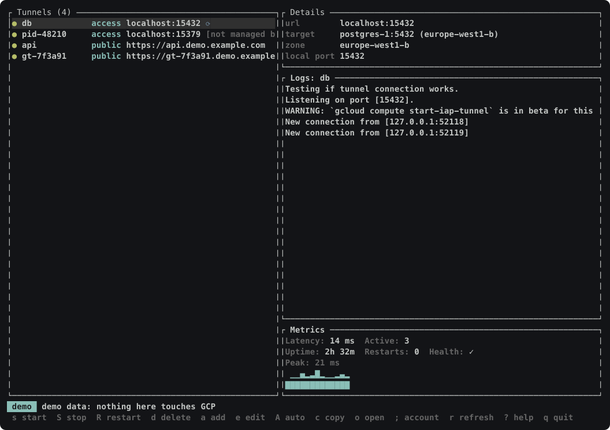

# gtunnel

A TUI-first manager for GCP IAP tunnels. Two modes, one binary:

| Mode | What it gives you | How |
|---|---|---|
| Access | A private port on `localhost` that reaches a VM port inside a VPC | `gcloud compute start-iap-tunnel` run as a managed service |
| Public | `https://<name>.<domain>` in front of a service on your laptop | Reverse SSH over IAP to a relay VM, published by a global HTTPS load balancer |

No inbound firewall rules, no public IP on the target, no agent on the VM. Access mode
creates nothing in GCP at all.

```
gtunnel                      # the TUI
gtunnel add db my-vm:5432    # localhost:15432 -> my-vm:5432
gtunnel expose web 3000      # https://web.example.com -> localhost:3000
```

The TUI, filled with the synthetic data `gtunnel demo` shows:



## Install

| Method | Command |
|---|---|
| Source | `cargo install --path .` |
| Release binary | Download `gtunnel-<target>.tar.gz` from Releases, verify the `.sha256`, extract |

Requires the Google Cloud SDK on `PATH` and an authenticated `gcloud` configuration.
macOS and Linux; the service backend is launchd or systemd `--user`.

`gtunnel update` replaces a downloaded binary in place, and tells you to use `brew` or
`cargo` when that is how it was installed.

## Getting started

```
gtunnel init                 # read a gcloud configuration into a gtunnel account
gtunnel add db my-vm:5432 -s # add an Access tunnel and start it
gtunnel list
```

For public URLs the account needs a relay, which is a one-off per account:

```
gtunnel domains add my-dns-zone
gtunnel relay up
gtunnel expose web 3000 -s
```

`gtunnel relay up` creates an e2-micro VM, a load balancer and a managed certificate.
That costs roughly USD 25/month per account and nothing per tunnel. `gtunnel relay down`
removes all of it.

## Documentation

| Document | Contents |
|---|---|
| [docs/usage.md](docs/usage.md) | Every command, with output |
| [docs/architecture.md](docs/architecture.md) | Topology, process model, resource names |
| [docs/troubleshooting.md](docs/troubleshooting.md) | Error table, IAP firewall and IAM, NumPy, service commands, cost |

## Safety

- Tunnels run as user services, restart on failure, and survive a reboot when auto-start is on.
- `gtunnel doctor` reports leftovers and misconfiguration; `--fix` removes only resources
  tagged `gtunnel:<account>` that no live tunnel claims.
- `gtunnel reset` removes local state only. Cloud resources go with `gtunnel relay down`.
- The self-updater verifies the published SHA-256 before it replaces anything.
