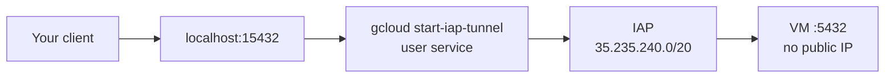
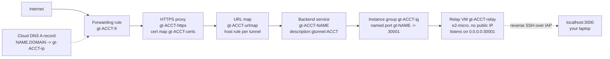
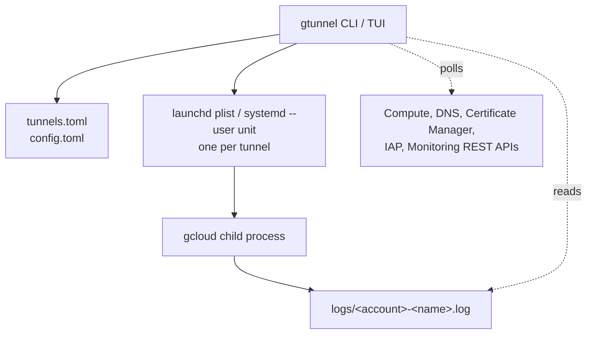

# Architecture

## Access mode

A local port forwarded to a port inside the VPC. Nothing is created in GCP: IAP already
accepts the connection, and the only requirement is a firewall rule that lets IAP's range
reach the target port.



The service runs:

```
gcloud compute start-iap-tunnel <instance> <remote-port> \
  --local-host-port=localhost:<local-port> --zone=<zone> [--project ...] [--impersonate-service-account ...]
```

With `--dest-group` the target is an IAP destination group instead of an instance, which
reaches a host that is not a compute instance.

## Public mode

A relay VM holds a reverse SSH tunnel back to your laptop. A global HTTPS load balancer
terminates TLS and sends each hostname to the relay port that belongs to that tunnel.



The tunnel process runs:

```
gcloud compute ssh <relay-vm> --zone=<zone> --tunnel-through-iap --quiet -- \
  -N -o ExitOnForwardFailure=yes -R 0.0.0.0:<relay-port>:localhost:<local-port>
```

`ExitOnForwardFailure=yes` matters: without it SSH stays up after the remote bind fails and
the tunnel looks healthy while serving nothing. The relay VM's startup script sets
`GatewayPorts clientspecified` so the `0.0.0.0` bind is accepted, which is what lets the load
balancer's health check reach the port.

## What belongs to whom

| Scope | Resource | Name | Created by |
|---|---|---|---|
| Per account | Relay VM | `gt-<acct>-relay` | `relay up` |
| Per account | Instance group | `gt-<acct>-ig` | `relay up` |
| Per account | Health check | `gt-<acct>-hc` | `relay up` |
| Per account | Default backend | `gt-<acct>-default` | `relay up` |
| Per account | URL map | `gt-<acct>-urlmap` | `relay up` |
| Per account | HTTPS proxy | `gt-<acct>-https` | `relay up` |
| Per account | Global address | `gt-<acct>-ip` | `relay up` |
| Per account | Forwarding rule | `gt-<acct>-fr` | `relay up` |
| Per account | Firewall, IAP to SSH | `gt-<acct>-iap-ssh` | `relay up` |
| Per account | Firewall, health check to 30000-30999 | `gt-<acct>-lb-hc` | `relay up` |
| Per account | Certificate map | `gt-<acct>-certs` | `relay up` |
| Per domain | Certificate and DNS authorization | `gt-<acct>-<domain-slug>`, `...-auth` | `domains add` |
| Per tunnel | Backend service | `gt-<acct>-<tunnel>` | `expose`, `run --public` |
| Per tunnel | Instance-group named port | `gt-<tunnel>` | `expose`, `run --public` |
| Per tunnel | URL-map host rule | the hostname | `expose`, `run --public` |
| Per tunnel | Cloud DNS A record, TTL 60 | `<tunnel>.<domain>.` | `expose`, `run --public` |

Both firewall rules target the tag `gt-relay`, which only the relay VM carries. Every
backend service gtunnel creates carries `description: gtunnel:<account>`, and that tag,
not the name, is what `doctor --fix` uses to decide whether a resource is gtunnel's. A
resource someone created by hand that happens to match the naming scheme is never deleted.

Port ranges: local ports 15000-15999, relay ports 30000-30998. Relay port 30999 is the
default backend, which has no listener, so an unknown hostname gets a 503 instead of
reaching another tunnel.

## Process model



| Concern | Decision |
|---|---|
| Supervision | launchd on macOS, systemd `--user` on Linux. Both restart on failure |
| Reboot | Auto-start is per tunnel; off by default, toggled with `A` in the TUI. On macOS it is the presence of the plist in `~/Library/LaunchAgents`, because launchd loads everything there at login and a `KeepAlive` job runs the moment it is loaded. The definition gtunnel starts and stops itself lives outside that directory |
| PATH | A daemon does not inherit a shell, so gcloud's directory is written into the unit. Without it the service dies at every start |
| Credentials | None stored. Each API call shells out to `gcloud auth print-access-token` for the account's configuration |
| Ephemeral runs | `run` writes a record with its pid, so `list`, the TUI and `doctor` see it. Every exit path tears the route down, including signals |
| Concurrent writes | Read-modify-write against a fingerprinted resource (URL map, named ports) retries up to 5 times on HTTP 412 |
| Metrics | Latency and connection count every 5s, health every 30s, load-balancer request counts every 60s over a 10-minute window |

## Files

| Path | Contents |
|---|---|
| `<config>/config.toml` | Accounts, default account, relay and domains per account |
| `<config>/tunnels.toml` | Persistent tunnels |
| `<config>/run/<account>-<name>.json` | One record per live `gtunnel run` |
| `<config>/agents/<label>.plist` | macOS: the service definition gtunnel loads and unloads |
| `~/Library/LaunchAgents/<label>.plist` | macOS: present only while auto-start is on |
| `<config>/logs/<account>-<name>.log` | Per-tunnel log, written by the service |
| `<config>/update-check.json` | Last version check |

`<config>` is `~/Library/Application Support/gtunnel` on macOS and
`~/.config/gtunnel` on Linux, and `GTUNNEL_CONFIG_DIR` overrides it.
