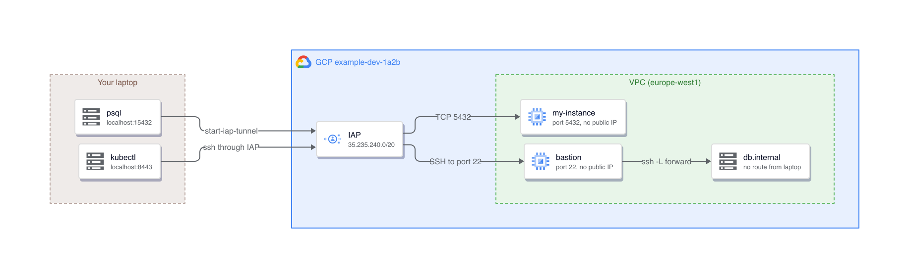
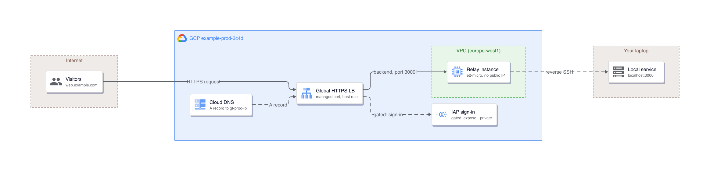

# Architecture

[Home](../README.md) / [Usage](usage.md) / [Commands](commands.md) / [Configuration](configuration.md) / Architecture / [Troubleshooting](troubleshooting.md)

What runs on your laptop, what lands in GCP and under which name, so you can audit every
resource gtunnel touches.

## Access mode

A local port forwarded to a port inside the VPC. Nothing is created in GCP: IAP already
accepts the connection, and the only requirement is a firewall rule that lets IAP's range
reach the target port. The TUI's instance picker reads the project's VPC firewall rules once
to mark the instances such a rule reaches (`iap`) and lists them first; it hides stopped
instances and GKE nodes until `Tab`.

Both inward paths, in one picture: the upper one is access mode, the lower one is the jump
tunnel described in the next section.



The `<zone>` is saved with the tunnel. `add` reads it from the project (one compute
`aggregated/instances` list filtered by the instance name) unless `--zone` is given, so the
record always holds the instance's own zone.

The service runs:

```
gcloud compute start-iap-tunnel <instance> <remote-port> \
  --local-host-port=localhost:<local-port> --zone=<zone> --verbosity=info \
  [--project ...] [--impersonate-service-account ...]
```

`--verbosity=info` makes a working tunnel say so, because gcloud's per-connection lines are
`log.info` and its default is `warning`. It and ssh's `LogLevel` below follow the configured
level ([One level, two scales](troubleshooting.md#one-level-two-scales)). The service also sets
`PYTHONUNBUFFERED=1`: Python block-buffers a stdout that is not a terminal, so a line would
wait for 4 KiB or the process exit.

With `--dest-group` the target is an IAP destination group instead of an instance, which
reaches a host that is not a compute instance.

## Jump tunnels

`--via <instance>` reaches a host only that instance can reach: a private GKE control plane, a
managed database on a private address, anything in the VPC with no IAP endpoint. In the
diagram's lower path IAP stops at the bastion, and the hop to `db.internal` is an `ssh -L`
forward from the far side. It is a different gcloud command, not a flag:

```
gcloud compute ssh <instance> --zone=<zone> --tunnel-through-iap --quiet \
  --verbosity=info [--project ...] -- \
  -N -o ExitOnForwardFailure=yes -o ServerAliveInterval=30 -o ServerAliveCountMax=3 \
  -o LogLevel=DEBUG -L <local-port>:<host>:<remote-port>
```

`--verbosity` governs gcloud, not the `ssh` it execs, so the forward carries its own
`LogLevel`; one setting drives both, mapped in
[One level, two scales](troubleshooting.md#one-level-two-scales).

Because the command is `ssh`, not `start-iap-tunnel`, gcloud has no local listener, so nothing
prints `Listening on port`; and the keepalive options are what notice a dead bastion, which
SSH would otherwise hold a forward open against.

## Expose mode

A relay instance holds a reverse SSH tunnel back to your laptop. A global HTTPS load balancer
terminates TLS and sends each hostname to the relay port that belongs to that tunnel.



The load balancer is drawn as one card. A request crosses forwarding rule, HTTPS proxy and
cert map, URL map (one host rule per tunnel), the tunnel's backend service, and the instance
group, whose named port selects the relay port; the DNS A record resolves to the global
address. Names are in [What belongs to whom](#what-belongs-to-whom).

A gated tunnel, `expose --private`, also turns on IAP for its backend service, so a visitor
signs in with Google before a request reaches the relay. `list` and the TUI show its mode
as `gated` rather than `public`.

Every backend service is created with a `timeoutSec` of 3600 (`expose.backend_timeout`, see
[configuration](configuration.md)), a 30 second connection-draining timeout and request logging
stated as off. The load balancer's own default is 30 seconds, which for a websocket is the
longest it may stay idle, so without the longer value hot reload and server-sent events
reconnect in a loop and a slow upload fails with a 502 or 504. GCP closes every websocket at
24 hours regardless.

The tunnel process runs:

```
gcloud compute ssh <relay-instance> --zone=<zone> --tunnel-through-iap --quiet -- \
  -N -o ExitOnForwardFailure=yes -R 0.0.0.0:<relay-port>:localhost:<local-port>
```

Without `ExitOnForwardFailure=yes`, SSH stays up after the remote bind fails and the tunnel
looks healthy while serving nothing. The relay's startup script sets
`GatewayPorts clientspecified` so the `0.0.0.0` bind is accepted and the load balancer's
health check can reach the port.

Every relay resource that has a wanted shape is converged, not only created: `relay up` reads
the health check, each backend service and the relay's startup script, and writes only what
differs. `expose`, `start` and `restart` converge the tunnel's backend the same way.

## What belongs to whom

| Scope | Resource | Name | Created by |
|---|---|---|---|
| Per account | Relay instance | `gt-<acct>-relay` | `relay up` |
| Per account | Instance group | `gt-<acct>-ig` | `relay up` |
| Per account | Health check | `gt-<acct>-hc` | `relay up` |
| Per account | Default backend | `gt-<acct>-default` | `relay up` |
| Per account | URL map | `gt-<acct>-urlmap` | `relay up` |
| Per account | HTTPS proxy | `gt-<acct>-https` | `relay up` |
| Per account | Global address | `gt-<acct>-ip` | `relay up` |
| Per account | Forwarding rule | `gt-<acct>-fr` | `relay up` |
| Per account | Firewall, IAP to SSH | `gt-<acct>-iap-ssh` | `relay up` |
| Per account | Firewall, health check to 30000-30999 | `gt-<acct>-lb-hc` | `relay up` |
| Per account | Certificate map | `gt-<acct>-certs` | `relay up` |
| Per domain | Certificate and DNS authorization | `gt-<acct>-<domain-slug>`, `...-auth` | `domains add` |
| Per tunnel | Backend service | `gt-<acct>-<tunnel>` | `expose`, `run --public` |
| Per tunnel | Instance-group named port | `gt-<tunnel>` | `expose`, `run --public` |
| Per tunnel | URL-map host rule | the hostname | `expose`, `run --public` |
| Per tunnel | Cloud DNS A record, TTL 60 | `<tunnel>.<domain>.` | `expose`, `run --public` |

Both firewall rules target the tag `gt-relay`, which only the relay instance carries. Every
backend service gtunnel creates carries `description: gtunnel:<account>`; how `doctor --fix`
uses that tag, and when it counts a host rule, named port or DNS record as its own, is in
[Leftovers](troubleshooting.md#leftovers).

Port ranges: local ports 15000-15999, relay ports 30000-30998. Relay port 30999 is the
default backend, which has no listener, so an unknown hostname gets a 503 instead of
reaching another tunnel.

### What `relay up` creates and `relay down` removes

![What relay up creates: on your laptop, gtunnel relay up creates the per-account resources once (HTTPS front end with global address, forwarding rule and HTTPS proxy; URL map with default backend and health check; relay instance and its instance group; firewall rules gt-ACCT-iap-ssh and gt-ACCT-lb-hc; certificate map gt-ACCT-certs), gtunnel domains add creates the per-domain certificate, DNS authorization and apex and wildcard certificate-map entries, and gtunnel expose or run --public creates the per-tunnel backend service and named port, URL-map host rule and Cloud DNS A record with TTL 60, all in GCP example-prod-3c4d; the certificate-map entries are added to the certificate map and the host rule to the URL map](images/architecture/gtunnel-relay-resources.png)


Every published service is its own supervised session to the same relay, on its own relay port.

`relay down` removes the per-account and per-domain halves, in dependency order: forwarding
rule, HTTPS proxy, global address, URL map, default backend, health check, each domain's
certificate-map entries, certificate and DNS authorization, the certificate map, the instance
group, the relay instance, then both firewall rules. It **refuses** while any expose tunnel or live
`gtunnel run --public` still holds a route — `--force` deletes those tunnels' routes and
services first. It never touches the Cloud DNS managed zone, which is yours.

## Process model

![Process model: on your laptop the gtunnel CLI / TUI reads and writes tunnels.toml and config.toml, installs one per-tunnel service (launchd plist / systemd unit) that runs gtunnel __supervise, which runs the gcloud child process and writes the tunnel log logs/&lt;account&gt;-&lt;name&gt;.log; the CLI reads that log and polls the Compute, Cloud DNS, Certificate Manager, IAP and Monitoring REST APIs in GCP; one machine watchdog (launchd StartInterval / systemd timer) runs gtunnel watch --once, which probes each service, writes breakers.toml and writes the log](images/architecture/gtunnel-process-model.png)

| Concern | Decision |
|---|---|
| Supervision | launchd on macOS, systemd `--user` on Linux. Both restart on failure. The supervisor answers a stop at once, during its restart backoff too. When gcloud exits it stops the rest of gcloud's process group (ssh, the IAP proxy), and a supervisor that was killed leaves its group's id beside the ready file for the next one to end, so nothing is left holding the port |
| Reboot | Auto-start is per tunnel; off by default, toggled with `A` in the TUI or `autostart`. How each platform holds it is under [Service lifecycle](#service-lifecycle) |
| Wedged tunnels | Supervision only catches a process that exits. A tunnel that stays up and refuses connections is caught instead by one watchdog job for the whole machine, which wakes every 30s by default (`watch.interval`), makes one pass over every tunnel and exits. It is an interval job rather than a supervised one precisely because it is supposed to exit every time |
| PATH | A daemon does not inherit a shell, so gcloud's directory is written into the unit. Without it the service dies at every start |
| Credentials | None stored ([decision 1](decisions.md#1-gtunnel-stores-no-credential)). Each API call shells out to `gcloud auth print-access-token` for the account's configuration, and an account with a `credential_file` adds `--credential-file-override=<path>` to every gcloud call. The Google API base URLs are fixed in a release build; a debug build lets `GTUNNEL_TEST_GCP_ENDPOINT` point them at one test server, which is how the binary-level tests fake GCP |
| Lists | A GCP list call is read to its last page, bounded at 50 pages and an error beyond that, so an entry on a later page is never read as absent. Looking up one Cloud DNS record asks for it by name and type and never lists the zone. See [A list that does not end](troubleshooting.md#a-list-that-does-not-end) |
| Ephemeral runs | `run` writes a record with gcloud's pid and that pid's start time, so `list`, the TUI and `doctor` see it and a recycled pid reads as gone, as does an exited process its parent has not reaped yet. A pid the system cannot inspect is unknown, never gone, so `reset` waits on it rather than delete under it. Nothing on a run's way out, and no command after `reset`, creates the config directory again. Every exit path stops gcloud's process group and tears the route down, including signals. A run and a saved tunnel never share a name in one account: `run` refuses a saved name, and `add`, `expose`, `rename` and `move` refuse a live run's |
| TUI polling | Discovery, metrics and health are three pollers (health reuses the metrics probe where one ran), each with at most one round in flight: a round slower than its period is waited for, never started again on top of itself. A result carries the generation its round began under and is dropped when that is no longer current, which is what an account switch does to every round begun for the old account. Every `gcloud`, `launchctl` and `systemctl` call is bounded (30s and 10s; the 10s is `service_call_timeout`, see [Settings the environment can override](configuration.md#settings-the-environment-can-override)) and fails with `<command> timed out after <n>s`; the child is killed on timeout. The `lsof` and `ps` reads run on the blocking pool. `delete` treats a timed-out stop as a failure and keeps the record, because removing it would orphan a job that may still be running |
| Strangers | A `[not managed by gtunnel]` row is an IAP process nothing here accounts for. One `ps` snapshot is read, then a process is gtunnel's if it forwards a port that any account's `tunnels.toml` entry or any run record owns, or if it sits below a pid launchd or a run record names. The port is tried first because launchd reports a supervisor's pid before the supervisor has spawned its gcloud child, and a verdict that depends on that gap is a verdict that depends on timing |
| Concurrent writes | Read-modify-write against a fingerprinted resource (URL map, named ports) retries `gcp.fingerprint_attempts` (5) times on HTTP 412 |
| Metrics | Latency every 5s, and health every 5s from the same probe: the health round skips a tunnel the metrics round probes that tick, because each probe is one IAP connection to the instance, and keeps the tunnels the metrics round does not cover. Load-balancer request counts every 60s over a 10-minute window. Connections are sampled every 500ms from one `lsof` listing covering every tunnel, and the 5s figure is the peak of that window: a request shorter than the window would otherwise be missed entirely |
| What counts as healthy | The probe half-closes and reads the far end. Bytes are an answer; silence for the whole budget is not. A close with no bytes is ambiguous, because gcloud closes after IAP refuses and a Postgres, Redis or HTTP server closes when it sees no request, so the tunnel's own log decides: the close is healthy unless the log gained a refusal line (`4003`, `4033`, `Reauthentication required`, `gcloud auth login`, `Error while connecting`, or an ssh `open failed`) while the probe was open. The log is read 250 ms after the close, and a log that cannot be read counts the close as healthy |

### Service lifecycle

One diagram for both platforms: the shape is the same and only the manager differs.

![Service lifecycle: gtunnel add records the tunnel in tunnels.toml (name, account, target, local port), gtunnel start or s in the TUI writes the definition labelled com.gtunnel.ACCOUNT.NAME, then on macOS launchctl bootstrap loads CONFIG/agents/LABEL.plist and on Linux systemctl --user start loads ~/.config/systemd/user/LABEL.service; both run the gcloud child process, which on any other non-zero exit is restarted by KeepAlive or Restart=on-failure RestartSec=5, while credentials expired leaves it Stays down with run/LABEL.auth and auth expired until gtunnel start clears it; A toggles auto-start, which on macOS is ~/Library/LaunchAgents/LABEL.plist starting at login and on Linux is systemctl --user enable plus loginctl enable-linger](images/architecture/gtunnel-service-lifecycle.png)

A restart cannot renew a login, so a supervisor that sees gcloud die of `Reauthentication required` (or of a denied impersonation, an invalid key or a missing configuration) stops the loop and leaves `run/<label>.auth` behind, holding the failure's name (`login-expired`, `impersonation-denied`, ...), which keeps `list` on `auth expired` or `credentials refused` after the log goes quiet. It exits 0 on macOS, where `KeepAlive` restarts every non-zero exit, and 78 on Linux, which the unit lists in `RestartPreventExitStatus`. `gtunnel start`, and the supervisor itself, clear the marker.

The two auto-start mechanisms are not symmetric, and the asymmetry is deliberate. On macOS
the flag *is* the file: launchd loads everything in `~/Library/LaunchAgents` at login, and a
`KeepAlive` job runs the moment it is loaded, so a definition left there would start whether
or not anyone asked. That is why the copy gtunnel loads and unloads itself lives in
`<config>/agents/` instead. On Linux the unit always lives in one place and `enable` is a
separate switch, with `loginctl enable-linger` deciding whether it survives a logout.

## Limits

An IAP tunnel is a WebSocket to Google, and Google publishes few numbers about it. Each row
names where it comes from.

| Fact | Source |
|---|---|
| No published quota on connections, bandwidth or tunnels. IAP "isn't intended for bulk transfer of data" and may rate-limit abuse | Google Cloud, IAP "Using TCP forwarding" |
| A session is dropped after one hour of inactivity | Same page |
| `start-iap-tunnel` opens one WebSocket and one thread per local TCP connection, with no cap; the listen backlog is 128 | gcloud 590, `command_lib/compute/iap_tunnel.py` |
| A dropped WebSocket is retried from 1.5 s up to 20 s apart, for up to 15 minutes | gcloud 590, `api_lib/compute/iap_tunnel_websocket.py` |
| Close code `4004` means IAP wants reauthentication; the session resumes | gcloud 590, `api_lib/compute/iap_tunnel_websocket_helper.py` |
| A tunnel through a GCP instance carries every connection over one WebSocket, kept busy by `ServerAliveInterval=30` | gtunnel, `src/tunnel.rs` (the command shown under [Jump tunnels](#jump-tunnels)) |
| Every tunable setting resolves in one place: a variable beats `config.toml`, which beats the default | gtunnel, `src/settings.rs`; [Settings the environment can override](configuration.md#settings-the-environment-can-override) |
| A gcloud that keeps dying before `min_uptime` stops its job after `max_restarts` fast failures | gtunnel, `src/restart_budget.rs`; [The restart budget](configuration.md#the-restart-budget) |

The two shapes pay differently.

| | Direct tunnel (`instance`, `dest_group`) | Through a GCP instance (`jump`) |
|---|---|---|
| Cost of a connection | One WebSocket and one TLS handshake each | A channel on the one WebSocket |
| One hour idle | Cuts that connection. An application's TCP keepalive does not help: it never leaves the local socket | Does not apply: ssh's keepalive keeps the one stream busy |
| Shared fate | None | Every connection rides one stream |

What to do about it:

| If | Then |
|---|---|
| A pool holds connections idle for an hour or more | Set the pool's idle lifetime under 60 minutes, or route through a GCP instance with `--via` |
| A burst opens many connections | Reuse them, or route through a GCP instance: each direct connection costs a handshake |
| A large copy | Do not do it over IAP; the page above says it is not for bulk transfer |

When gcloud reconnects, the log keeps the `4004` close and the `Reconnecting with URL` line,
and a tunnel that gave up logs `Unable to reconnect within`
([what the log says](troubleshooting.md#what-the-log-says-and-what-it-means)).

## MCP server

An agent drives gtunnel through the same binary a person uses: `gtunnel mcp` speaks JSON-RPC 2.0 on stdin and stdout, so there is no runtime to install and no daemon to keep. The tools are listed in [usage.md](usage.md#the-native-mcp-server); this section is how they are built.

![MCP server: an MCP client on the laptop talks JSON-RPC 2.0 over stdio to gtunnel mcp, whose tool table in src/mcp/tools.rs makes locked writes to tunnels.toml and config.toml, starts and stops the per-tunnel launchd or systemd service, and for run_tunnel spawns gtunnel run in its own process group with a TTL; gtunnel run writes the run record run/ACCT-NAME.json and the run log logs/run-ACCT-NAME.log and opens an IAP tunnel in GCP example-dev-1a2b, while the server waits up to 5s for the run record](images/architecture/gtunnel-mcp.png)

| Piece | Where | Decision |
|---|---|---|
| Stdio server | `src/mcp/server.rs` | One JSON-RPC message per line. Stdout carries frames and nothing else, so a login prompt there would corrupt the protocol and `mcp` skips the login check. A `notifications/...` message gets no reply |
| Tool table | `src/mcp/tools.rs`: `all_tools`, `all_resources` | The one source of names and schemas. `tools/list` serves it, and `gtunnel mcp --validate` (`src/mcp/validator.rs`) checks every definition against it |
| Stateless era | `modern_version`, `stamp_modern` in `src/mcp/protocol.rs` | A request is modern when `params._meta` carries the protocol version key, never by method name, so legacy traffic is untouched. `2026-07-28` is the only modern version; an unknown one is `-32022` listing it. `server/discover` and every modern result carry `resultType` and the server identity in `_meta` |
| Handshake | `negotiate_version` in `src/mcp/protocol.rs` | Echoes the client's revision when it is one of `2025-11-25`, `2025-06-18`, `2024-11-05`, and offers `2025-11-25` otherwise, so a newer client stays on this handshake |
| Tool metadata | `ToolDefinition` | `title`, four always-present annotation hints and, for the six tools that answer in JSON, an `outputSchema` that admits the error envelope too, because a structured result must conform even when it is a failure |
| Dispatch | `execute_tool`, `read_resource` | A failed operation, including an unknown account or tunnel, is a result with `isError` and a `kind`, the same kinds the CLI's `--json` errors carry: a GCP 401 or 403 is `auth`, a 404 is `not_found`. Only parameters the server cannot act on are JSON-RPC errors |
| Accounts | `accounts_payload` | The `gtunnel_list_accounts` tool and the `gtunnel://accounts` resource call one function, so the two cannot describe the selection differently |
| Run launcher | `src/mcp/run.rs`: `launch` | Spawns `gtunnel run <name> <target> --ttl <n>m` in its own process group, so the tunnel outlives the server and the TTL is its only owner. Waits `LAUNCH_BUDGET` (5s) for the run record, and on failure returns the log's tail as the tool error |
| Run lookup | `find_live_run`, `live_run_log` | `stop`, `status` and `logs` look for a saved tunnel first and a live run second, in the CLI and in the tools alike |

## Files

`tunnels.toml` also holds `[[reservations]]`: an `expose` that has claimed its name and relay port
and is still building its route. It is not a tunnel, so nothing lists it, and `doctor --fix`
removes one older than ten minutes.

Keys, defaults and the traps of editing `config.toml` and `tunnels.toml` are in
[configuration.md](configuration.md); this table is the inventory of the directory.

| Path | Contents |
|---|---|
| `<config>/config.toml` | Accounts, default account, relay and domains per account. `config_version = 2` marks a file written since notifications went off by default: loading an older one switches them off and saves it once, without waiting on `config.lock`. Only an interactive command says so on stderr; the watchdog, the supervisor and `mcp` never do |
| `<config>/tunnels.toml` | Persistent tunnels |
| `<config>/tunnels.lock`, `<config>/config.lock` | Empty files whose only job is to be locked. A command or the TUI's config page that changes `tunnels.toml` or `config.toml` holds the matching lock from its read to its write, so two gtunnels cannot drop each other's change. Safe to delete when no gtunnel is running |
| `<config>/tunnels.edit-<pid>.toml`, `<config>/config.edit-<pid>.toml` | The config page's private copy of the file being edited. Removed on save or `Esc`, and on the next page open once its gtunnel is gone |
| `<config>/run/<account>-<name>.json` | One record per live `gtunnel run`, naming its owner process. `list` and every watchdog pass stop a run whose owner has died or whose TTL has passed: its route, its gcloud group and this record. The TUI import waits for the owner to exit before taking the tunnel over |
| `<config>/run/<label>.ready` | Written by a tunnel's supervisor once its log reports the listener; what `start` waits for |
| `<config>/run/<label>.crash` | Written by a supervisor whose tunnel spent its restart budget: the last exit reason. `list` reads it, `watch` skips the job, `start` and `delete` remove it |
| `<config>/run/<label>.restarts` | The times of the recent fast failures, one unix second per line, kept because the service manager starts a new supervisor per attempt |
| `<config>/run/probes/` | One file per local port gtunnel is probing, so the supervisor leaves gtunnel's own health checks out of the `conn` lines |
| `<config>/run/watchdog.heartbeat` | Time of the watchdog's last pass. `watch status` reports its age; while it is under 90s old (three intervals when `watch.interval` is above 30s) the TUI leaves notifications to the watchdog |
| `<config>/lifecycle.json`, `<config>/lifecycle.lock` | The last state each tunnel was seen in, shared by the watchdog, the TUI and the CLI so that a change is notified once. The lock serialises its updates |
| `<config>/agents/<label>.plist` | macOS: the service definition gtunnel loads and unloads. Written atomically, like every file under `<config>`. Rewritten by the first command after an upgrade when it differs from what the new binary renders (`src/daemon/refresh.rs`); a running tunnel is restarted, a stopped one is not |
| `~/Library/LaunchAgents/<label>.plist` | macOS: present only while auto-start is on |
| `<config>/breakers.toml`, `<config>/breakers.lock` | One row per tunnel: what the watchdog has seen of it, and how far up the restart ladder it is. Rewritten whole on every pass, by writing a sibling file and renaming it, and pruned to the tunnels that still exist. A pass holds the lock from its read to its write, so a second watchdog skips its round instead of overwriting the first one's decisions |
| `<config>/logs/watchdog.log` | What the watchdog did. A pass where nothing needed doing writes nothing |
| `<config>/logs/<account>-<name>.log` | Per-tunnel log, written by the service |
| `<config>/logs/run-<account>-<name>.log` | Output of a `gtunnel run` that `gtunnel_run_tunnel` started. A run started in a terminal prints there and has no file |
| `<config>/update-check.json` | Last version check |

Where `<config>` is, and how every file in it is written (atomically, mode 0600, under a
lock), is in [Where the files live](configuration.md#where-the-files-live).

### The account and config model

![The account and config model: tunnels.toml holds dev / kubernetes and prod / kubernetes, each identified by name plus account_name, and each derives its own artifacts: launchd plist com.gtunnel.dev.kubernetes, log logs/dev-kubernetes.log and localhost:8443 for dev, and com.gtunnel.prod.kubernetes, logs/prod-kubernetes.log and localhost:8444 for prod; config.toml holds accounts (gcloud configuration, project, zone) and default_account, and each account has its relay (instance, zone, load balancer) and its domains](images/architecture/gtunnel-config-model.png)

A tunnel is identified by its name **and** its account, never by name alone, which is what
lets `kubernetes` exist once per account. Every artifact derived from a tunnel carries the
account in its own name — the launchd label, the log file, the run record — so two accounts'
copies never collide on disk or in the service manager. What must differ between them is the
local port, because both run on one laptop.

The practical consequence is that a tunnel is named for what it connects to, never for its
account: [Naming a tunnel](commands.md#naming-a-tunnel).
