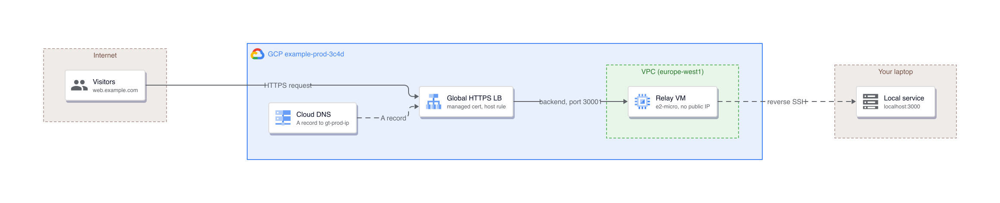
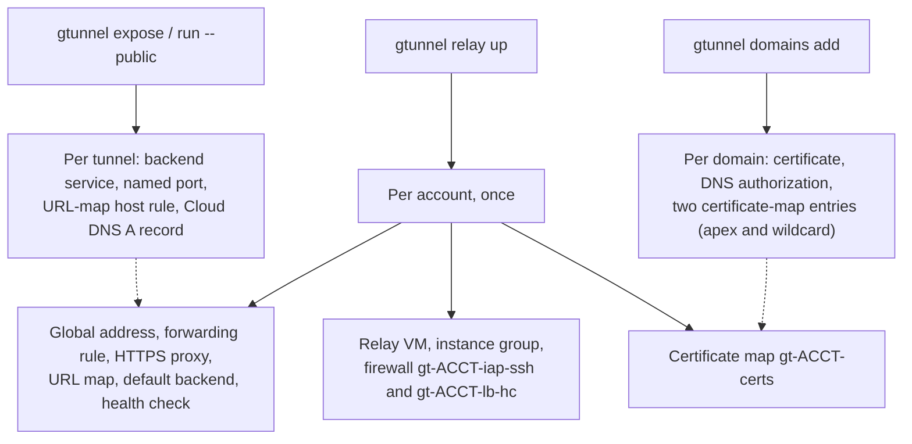
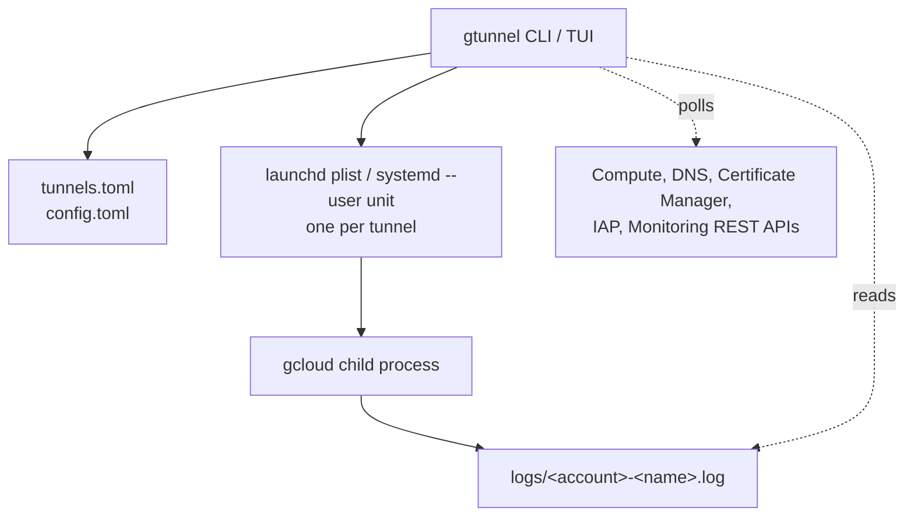
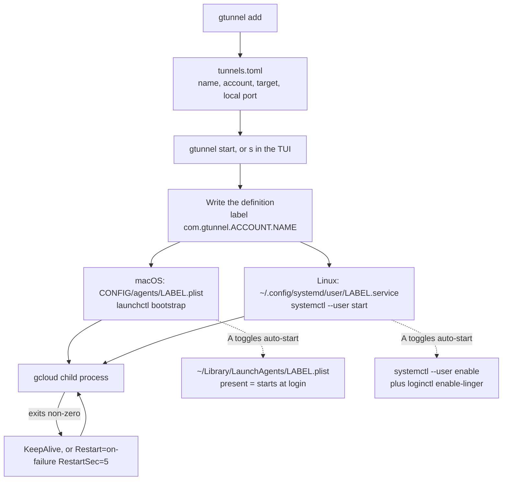
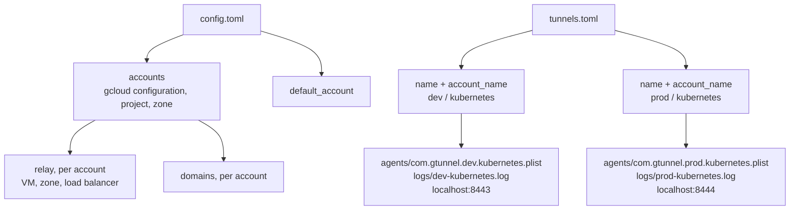

# Architecture

## Access mode

A local port forwarded to a port inside the VPC. Nothing is created in GCP: IAP already
accepts the connection, and the only requirement is a firewall rule that lets IAP's range
reach the target port.

Both inward paths, in one picture: the upper one is access mode, the lower one is the jump
tunnel described in the next section.


The service runs:

```
gcloud compute start-iap-tunnel <instance> <remote-port> \
  --local-host-port=localhost:<local-port> --zone=<zone> --verbosity=info \
  [--project ...] [--impersonate-service-account ...]
```

`--verbosity=info` is what makes a working tunnel say so: gcloud's per-connection lines are
`log.info` and its default level is `warning`. The service also sets `PYTHONUNBUFFERED=1`,
because gcloud is Python and Python block-buffers a stdout that is not a terminal, so without
it a line waits for 4 KiB or for the process to exit.

With `--dest-group` the target is an IAP destination group instead of an instance, which
reaches a host that is not a compute instance.

## Jump tunnels

`--via <instance>` reaches a host that only that instance can reach: a private GKE control
plane, a managed database on a private address, anything inside the VPC with no IAP
endpoint of its own. It is the lower path in the diagram above: IAP stops at the bastion,
and the hop from there to `db.internal` is an `ssh -L` forward made from the far side.

This is a different gcloud command, not a different flag. IAP carries an SSH connection and
SSH makes the forward, so the service runs:

```
gcloud compute ssh <instance> --zone=<zone> --tunnel-through-iap --quiet \
  --verbosity=info [--project ...] -- \
  -N -o ExitOnForwardFailure=yes -o ServerAliveInterval=30 -o ServerAliveCountMax=3 \
  -o LogLevel=DEBUG -L <local-port>:<host>:<remote-port>
```

`--verbosity` governs gcloud, not the `ssh` it execs, so the forward needs its own level.
`DEBUG` rather than `VERBOSE`: ssh's levels run `QUIET < FATAL < ERROR < INFO < VERBOSE <
DEBUG`, and both lines worth having here — the forward coming up, and one per client
connecting — are `debug()`. At `VERBOSE` ssh prints three lines for a whole session and
nothing per connection.

Two consequences follow from the command being `ssh` rather than `start-iap-tunnel`:
there is no local listener inside gcloud, so nothing prints `Listening on port`; and the
keepalive options are what notice a dead bastion, since SSH will otherwise hold a forward
open against a host that is gone.

## Public mode

A relay VM holds a reverse SSH tunnel back to your laptop. A global HTTPS load balancer
terminates TLS and sends each hostname to the relay port that belongs to that tunnel.



The load balancer is drawn as one card. Behind it a request crosses five resources, which
[What belongs to whom](#what-belongs-to-whom) below lists in full: the forwarding rule
`gt-<acct>-fr`, the HTTPS proxy `gt-<acct>-https` with cert map `gt-<acct>-certs`, the URL
map `gt-<acct>-urlmap` carrying one host rule per tunnel, the per-tunnel backend service
`gt-<acct>-<tunnel>`, and the instance group `gt-<acct>-ig` whose named port `gt-<tunnel>`
selects the relay port. The Cloud DNS A record `<tunnel>.<domain>` resolves to the global
address `gt-<acct>-ip`.

The tunnel process runs:

```
gcloud compute ssh <relay-vm> --zone=<zone> --tunnel-through-iap --quiet -- \
  -N -o ExitOnForwardFailure=yes -R 0.0.0.0:<relay-port>:localhost:<local-port>
```

`ExitOnForwardFailure=yes` matters: without it SSH stays up after the remote bind fails and
the tunnel looks healthy while serving nothing. The relay VM's startup script sets
`GatewayPorts clientspecified` so the `0.0.0.0` bind is accepted, which is what lets the load
balancer's health check reach the port.

## What belongs to whom

| Scope | Resource | Name | Created by |
|---|---|---|---|
| Per account | Relay VM | `gt-<acct>-relay` | `relay up` |
| Per account | Instance group | `gt-<acct>-ig` | `relay up` |
| Per account | Health check | `gt-<acct>-hc` | `relay up` |
| Per account | Default backend | `gt-<acct>-default` | `relay up` |
| Per account | URL map | `gt-<acct>-urlmap` | `relay up` |
| Per account | HTTPS proxy | `gt-<acct>-https` | `relay up` |
| Per account | Global address | `gt-<acct>-ip` | `relay up` |
| Per account | Forwarding rule | `gt-<acct>-fr` | `relay up` |
| Per account | Firewall, IAP to SSH | `gt-<acct>-iap-ssh` | `relay up` |
| Per account | Firewall, health check to 30000-30999 | `gt-<acct>-lb-hc` | `relay up` |
| Per account | Certificate map | `gt-<acct>-certs` | `relay up` |
| Per domain | Certificate and DNS authorization | `gt-<acct>-<domain-slug>`, `...-auth` | `domains add` |
| Per tunnel | Backend service | `gt-<acct>-<tunnel>` | `expose`, `run --public` |
| Per tunnel | Instance-group named port | `gt-<tunnel>` | `expose`, `run --public` |
| Per tunnel | URL-map host rule | the hostname | `expose`, `run --public` |
| Per tunnel | Cloud DNS A record, TTL 60 | `<tunnel>.<domain>.` | `expose`, `run --public` |

Both firewall rules target the tag `gt-relay`, which only the relay VM carries. Every
backend service gtunnel creates carries `description: gtunnel:<account>`, and that tag,
not the name, is what `doctor --fix` uses to decide whether a resource is gtunnel's. A
resource someone created by hand that happens to match the naming scheme is never deleted.

Port ranges: local ports 15000-15999, relay ports 30000-30998. Relay port 30999 is the
default backend, which has no listener, so an unknown hostname gets a 503 instead of
reaching another tunnel.

### What `relay up` creates and `relay down` removes



Everything above except the DNS record carries `description: gtunnel:<account>`. A Cloud DNS
record has no description field, so gtunnel treats one as its own only while it still holds a
tagged backend, host rule or named port for the same tunnel.

`relay down` removes the per-account and per-domain halves, in dependency order: forwarding
rule, HTTPS proxy, global address, URL map, default backend, health check, each domain's
certificate-map entries, certificate and DNS authorization, the certificate map, the instance
group, the relay VM, then both firewall rules. It **refuses** while any expose tunnel or live
`gtunnel run --public` still holds a route — `--force` deletes those tunnels' routes and
services first. It never touches the Cloud DNS managed zone, which is yours.

## Process model



| Concern | Decision |
|---|---|
| Supervision | launchd on macOS, systemd `--user` on Linux. Both restart on failure |
| Reboot | Auto-start is per tunnel; off by default, toggled with `A` in the TUI. On macOS it is the presence of the plist in `~/Library/LaunchAgents`, because launchd loads everything there at login and a `KeepAlive` job runs the moment it is loaded. The definition gtunnel starts and stops itself lives outside that directory |
| PATH | A daemon does not inherit a shell, so gcloud's directory is written into the unit. Without it the service dies at every start |
| Credentials | None stored. Each API call shells out to `gcloud auth print-access-token` for the account's configuration |
| Ephemeral runs | `run` writes a record with its pid, so `list`, the TUI and `doctor` see it. Every exit path tears the route down, including signals |
| Concurrent writes | Read-modify-write against a fingerprinted resource (URL map, named ports) retries up to 5 times on HTTP 412 |
| Metrics | Latency every 5s, health every 30s, load-balancer request counts every 60s over a 10-minute window. Connections are sampled every 500ms from one `lsof` listing covering every tunnel, and the 5s figure is the peak of that window: a request shorter than the window would otherwise be missed entirely |

### Service lifecycle

One diagram for both platforms: the shape is the same and only the manager differs.



The two auto-start mechanisms are not symmetric, and the asymmetry is deliberate. On macOS
the flag *is* the file: launchd loads everything in `~/Library/LaunchAgents` at login, and a
`KeepAlive` job runs the moment it is loaded, so a definition left there would start whether
or not anyone asked. That is why the copy gtunnel loads and unloads itself lives in
`<config>/agents/` instead. On Linux the unit always lives in one place and `enable` is a
separate switch, with `loginctl enable-linger` deciding whether it survives a logout.

## Files

| Path | Contents |
|---|---|
| `<config>/config.toml` | Accounts, default account, relay and domains per account |
| `<config>/tunnels.toml` | Persistent tunnels |
| `<config>/run/<account>-<name>.json` | One record per live `gtunnel run` |
| `<config>/agents/<label>.plist` | macOS: the service definition gtunnel loads and unloads |
| `~/Library/LaunchAgents/<label>.plist` | macOS: present only while auto-start is on |
| `<config>/logs/<account>-<name>.log` | Per-tunnel log, written by the service |
| `<config>/update-check.json` | Last version check |

`<config>` is `~/Library/Application Support/gtunnel` on macOS and
`~/.config/gtunnel` on Linux, and `GTUNNEL_CONFIG_DIR` overrides it.

### The account and config model



A tunnel is identified by its name **and** its account, never by name alone, which is what
lets `kubernetes` exist once per account. Every artifact derived from a tunnel carries the
account in its own name — the launchd label, the log file, the run record — so two accounts'
copies never collide on disk or in the service manager. What must differ between them is the
local port, because both run on one laptop.

The practical consequence is a naming rule: a tunnel is named for what it connects to, never
for the account it lives in. An account suffix is redundant everywhere it could appear, and
it costs you the ability to use the same command in both accounts.
