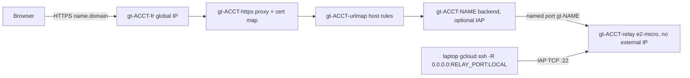

# gtunnel Implementation Plan

> **For agentic workers:** REQUIRED SUB-SKILL: Use superpowers:subagent-driven-development (recommended) or superpowers:executing-plans to implement this plan task-by-task. Steps use checkbox (`- [ ]`) syntax for tracking.

**Goal:** A TUI-first Rust CLI that does for GCP what ytunnel does for Cloudflare: persistent, daemon-managed tunnels with a live dashboard, in two modes. **Access** forwards a private GCP port to localhost over IAP TCP forwarding. **Expose** publishes a local service at `https://<name>.<domain>` through a GCP relay.

**Architecture:** gtunnel is a management tool, not a daemon. Every tunnel is one `gcloud` child process supervised by launchd (macOS) or systemd `--user` (Linux). Access tunnels run `gcloud compute start-iap-tunnel`. Expose tunnels run `gcloud compute ssh --tunnel-through-iap -- -N -R` into a shared relay VM that sits behind a global external Application Load Balancer, with a Certificate Manager wildcard cert and Cloud DNS records. GCP resources are managed over REST (reqwest), using a token obtained from `gcloud auth print-access-token`.

**Tech Stack:** Rust 2021 (latest stable), clap 4, tokio 1, reqwest 0.12 (rustls), serde/serde_json/toml 0.8, ratatui 0.30, crossterm 0.29, dirs 6, anyhow 1, rand 0.9, libc 0.2. Dev dependencies: wiremock 0.6, tempfile 3.

**Spec:** This document, section "Design". It is derived from the ytunnel v1.0.0 source (MIT, github.com/yetidevworks/ytunnel), which was read during research. The executor should clone that repo read-only for reference when porting the TUI (`src/tui/app.rs`, `src/tui/ui.rs`) and `src/update.rs`.

## Design

### Feature mapping from ytunnel

| ytunnel | gtunnel Access | gtunnel Expose |
|---|---|---|
| `add NAME TARGET [-z] [--start]` | `add NAME INSTANCE:PORT [-z ZONE] [--local-port N] [--start]`, or `add NAME HOST:PORT --dest-group G --region R --network N` | `expose NAME LOCAL_TARGET [-d DOMAIN] [--private] [--start]` |
| `run [NAME] TARGET [-z]` (ephemeral) | `run [NAME] INSTANCE:PORT [-z] [--local-port]` | `run --public [NAME] LOCAL_TARGET [-d]` |
| `start/stop/restart/delete/logs [-f] [-n]/list` | same | same, plus route cleanup on delete |
| accounts = CF API tokens | accounts = gcloud configuration + project (+ optional impersonated SA) | same |
| zones = DNS zones | `zones [default Z]` = compute zones | `domains [default D]` = Cloud DNS managed zones registered with the relay |
| DNS CNAME per tunnel | none | A record `<name>.<domain>` pointing at the LB IP |
| Prometheus metrics | TCP probe latency, active connections, uptime, restarts | same, plus LB request count and status classes (Cloud Monitoring) |
| Health check every 30s + notifications | TCP connect to `localhost:<local_port>` | HTTP GET of the public URL (ytunnel `classify_health`) |
| `[not managed by ytunnel]` read-only entries | running `start-iap-tunnel` processes not started by gtunnel | none |
| `[ephemeral]` entries + `m` import | registry file `run/<name>.json` written by `run` | same |
| `doctor [--fix] [--yes] [--all]` | stale state, missing instance, firewall/IAM preflight, port conflicts, dead ephemeral markers, gcloud auth, numpy | plus orphaned DNS, backends, host rules, named ports; relay and cert health |
| `reset`, `demo`, `update [--check]`, `account list/select/default/remove`, `init` | same | `relay up/down/status`, `domains add` |

### Expose topology (one relay per account)



- Relay VM: e2-micro, image family `debian-12`, tag `gt-relay`, no external IP. Its startup script sets `GatewayPorts clientspecified` in sshd_config and restarts ssh.
- Firewalls: `gt-ACCT-iap-ssh` (35.235.240.0/20 to tcp:22) and `gt-ACCT-lb-hc` (130.211.0.0/22, 35.191.0.0/16 to tcp:30000-30999), both targeting tag `gt-relay`.
- One shared TCP health check `gt-ACCT-hc` with `portSpecification: USE_SERVING_PORT`. The default backend `gt-ACCT-default` uses named port `gt-default:30999`, which has no listener, so unknown hosts get a 503.
- Per-tunnel backend services are chosen over a reverse proxy on the VM because IAP (`--private`) is configured per backend service and every resource stays visible to `doctor`.
- Certificates: one Certificate Manager DNS authorization and one cert (`*.domain` + `domain`) per domain, attached to cert map `gt-ACCT-certs`.
- `relay up` prints the cost before confirming: "Global forwarding rule (~USD 18/month) and e2-micro VM (~USD 7/month, free tier in some US regions)".

### Files

```
Cargo.toml  LICENSE  README.md  .gitignore  .github/workflows/{ci.yml,release.yml}
docs/usage.md  docs/architecture.md  docs/troubleshooting.md
src/main.rs            dispatch only
src/cli.rs             clap definitions
src/config.rs          accounts, config dir, load/save
src/state.rs           tunnels.toml, TunnelSpec, name validation, port allocation
src/ephemeral.rs       run/ registry + foreground run loop
src/commands/{mod.rs,access.rs,expose.rs,account.rs,maint.rs}   CLI command bodies
src/tunnel.rs          gcloud argv builders, gcloud discovery, log diagnosis
src/daemon/{mod.rs,launchd.rs,systemd.rs}
src/gcp/{mod.rs,client.rs,compute.rs,dns.rs,certmanager.rs,iap.rs,monitoring.rs,gcloud.rs}
src/expose/{mod.rs,naming.rs,relay.rs,routes.rs}
src/probe.rs           probes, connection counts, metrics struct
src/discovery.rs       external iap process parsing
src/notify.rs
src/doctor.rs
src/update.rs
src/tui/{mod.rs,app.rs,ui.rs,ops.rs,demo.rs}
```

## Global Constraints

- Binary and crate name: `gtunnel`. Config dir: `dirs::config_dir()/gtunnel`, overridable with the env var `GTUNNEL_CONFIG_DIR` (tests always set it to a tempdir).
- Files in the config dir: `config.toml`, `tunnels.toml`, `logs/<account>-<name>.log`, `run/<account>-<name>.json`, `update-check.json`.
- Daemon labels: launchd `com.gtunnel.<account>.<name>` (plist in `~/Library/LaunchAgents/`). systemd `gtunnel-<account>-<name>.service` (in `~/.config/systemd/user/`).
- Account names match `^[a-z][a-z0-9-]{0,15}$`. Tunnel names match `^[a-z]([-a-z0-9]{0,38}[a-z0-9])?$` (at most 40 characters, so `gt-<acct>-<name>` stays within 63 and is a valid DNS label).
- Port ranges: Access local ports 15000-15999. Relay ports 30000-30998 (30999 is reserved for the default backend).
- Every gcloud invocation passes `--configuration=<acct.gcloud_configuration>` and `--project=<acct.project>`, plus `--impersonate-service-account=<sa>` when set. Daemons get the env vars `CLOUDSDK_CORE_DISABLE_PROMPTS=1` and `PATH=<dir of gcloud>:/opt/homebrew/bin:/usr/local/bin:/usr/bin:/bin`.
- Comments use `//`, not `///`, except on public API (ytunnel convention).
- No emojis in docs, commits or comments. TUI status glyphs (`●○✗⟳⚠`) are UI and allowed.
- Commit messages carry no Claude attribution. Never commit `target/` or binaries.
- LICENSE: MIT for gtunnel, followed by the ytunnel MIT notice ("Copyright (c) YetiDevWorks") for the ported TUI and update code.
- Git: the repo has no commits yet. Task 1 creates `main` with the initial commit, then branch `feat/gtunnel-v1`. One PR for everything, by the repo owner's choice; this overrides the global ">20 files means split" rule.
- Every `git commit` step needs the repo owner's approval unless they pre-approve commits at execution start.

## Review Focus

1. A daemon starts while gcloud is missing from launchd's PATH or its credentials have expired. Expected: the status shows Error and the log hint says what to run. Not "Running" while it is dead. Pinned in Task 5 (PATH in rendered units) and Task 4 (auth diagnosis).
2. The chosen local port is already in use by another app. Expected: `add` picks the next free port in range, or names the conflict; `start` reports it. Pinned in Task 3 (`allocate_port` skips ports that are not free).
3. IAP error 4003 (firewall) or 4033 (IAM). Expected: an actionable hint naming the fix, not a raw log. Pinned in Task 4.
4. A concurrent URL map or instance-group edit returns HTTP 412 on fingerprint mismatch. Expected: read-modify-write retries up to 5 times and then succeeds. Pinned in Task 9.
5. `relay down` while Expose tunnels still exist. Expected: refuse and list them unless `--force`; with `--force`, remove their routes and daemons first. Pinned in Task 8.

---

### Task 1: Scaffold, CLI surface, CI

**Files:**
- Create: `Cargo.toml`, `.gitignore` (`/target`), `LICENSE`, `src/main.rs`, `src/cli.rs`, `.github/workflows/ci.yml`

**Interfaces:**
- Produces: `cli::Cli { account: Option<String>, command: Option<Commands> }`. `Commands` variants: `Init`, `Add{name,target,zone,local_port,dest_group,region,network,start}`, `Expose{name,target,domain,private,start}`, `Run{args:Vec<String> (1..=2),zone,local_port,public:bool,domain}`, `Start{name}`, `Stop{name}`, `Restart{name}`, `Logs{name,follow,lines=50}`, `List`, `Delete{name}`, `Zones{command:Option<ZonesCommands::Default{zone}>}`, `Domains{command:Option<DomainsCommands::{Default{domain},Add{managed_zone}}>}`, `Relay{command: RelayCommands::{Up{zone,network,managed_zone,yes},Down{force,yes},Status}}`, `Account{command:Option<AccountCommands::{List,Select{name},Default{name},Remove{name,yes}}>}`, `Doctor{fix,yes,all}`, `Reset{yes}`, `Demo`, `Update{check}`.
- `main.rs` dispatches each variant to a function that returns `anyhow::bail!("not implemented")` until its task lands. No subcommand opens the TUI.

- [ ] **Step 1: Write failing tests** in `src/cli.rs` `#[cfg(test)]`. `parse(&["gtunnel","add","db","my-vm:5432","-z","europe-west1-b","--local-port","15432","--start"])` gives `Add` with `local_port==Some(15432)`, `start==true`. `run --public api localhost:3000` gives `Run{public:true,args:["api","localhost:3000"]}`. `relay down --force` gives `Down{force:true}`. Use `Cli::try_parse_from`.
- [ ] **Step 2:** Run `cargo test cli::` and expect FAIL (types missing).
- [ ] **Step 3:** Implement `cli.rs` with clap derive and `main.rs` dispatch. `ci.yml` runs on push and PR over ubuntu-latest and macos-latest: `cargo fmt --check`, `cargo clippy -- -D warnings`, `cargo test`.
- [ ] **Step 4:** Run `cargo test && cargo clippy -- -D warnings` and expect PASS with no warnings. Run `cargo run -- --help` and show the output.
- [ ] **Step 5:** Commit on `main` ("chore: scaffold gtunnel"), then `git checkout -b feat/gtunnel-v1`.

### Task 2: Config and accounts

**Files:** Create `src/config.rs`

**Interfaces:**
- Produces: `Config{selected_account:String, accounts:Vec<Account>}`, `Account{name, gcloud_configuration, project, default_zone, impersonate_service_account:Option<String>, expose:Option<ExposeConfig>}`, `ExposeConfig{relay_instance, relay_zone, network, default_domain, domains:Vec<DomainConfig>}`, `DomainConfig{domain, managed_zone}`.
- `config_dir()->Result<PathBuf>`, `load_config()->Result<Config>` (error text when missing: "gtunnel is not initialized. Run `gtunnel init`."), `save_config(&Config)->Result<()>` (file mode 0600).
- `impl Config { get_account(&self, Option<&str>)->Result<&Account>; get_account_mut; add_account(Account)->Result<()> (rejects duplicates and invalid names); remove_account(&str)->Result<Account> (moves selection to the first remaining account); select_account(&str)->Result<()> }`.
- `validate_account_name(&str)->Result<()>`.

- [ ] **Step 1: Failing tests:** round trip through a tempdir (`GTUNNEL_CONFIG_DIR`); `get_account(None)` returns the selected account; `get_account(Some("nope"))` errors with "Account 'nope' not found"; `remove_account` of the selected account selects the first remaining one; `validate_account_name("Prod")` and a 17-character name are Err; `"prod-eu"` is Ok; the saved file mode is `0o600`.
- [ ] **Step 2:** `cargo test config::` fails.
- [ ] **Step 3:** Implement.
- [ ] **Step 4:** `cargo test config::` passes.
- [ ] **Step 5:** Commit "feat: config and accounts".

### Task 3: Tunnel state, names, ports

**Files:** Create `src/state.rs`

**Interfaces:**
- Consumes: `config::config_dir`.
- Produces:
  - `TunnelStatus{Running,Stopped,Error}` with `symbol()` (`●○✗`).
  - `#[serde(tag="mode", rename_all="snake_case")] enum TunnelSpec { Access{target:AccessTarget, remote_port:u16, local_port:u16}, Expose{local_target:String, domain:String, hostname:String, relay_port:u16, private:bool} }`.
  - `#[serde(tag="kind", rename_all="snake_case")] enum AccessTarget { Instance{instance:String, zone:String}, DestGroup{host:String, region:String, group:String, network:String} }`.
  - `PersistentTunnel{name, account_name, spec:TunnelSpec, auto_start:bool}` with `log_path()->Result<PathBuf>`, `label()->String` (`<account>-<name>`), `display_url()->String` (Access: `localhost:<lp>`; Expose: `https://<hostname>`), `display_target()->String` (Access: `my-vm:5432 (europe-west1-b)` or `10.0.0.5:5432 via dest-group g`; Expose: the local target).
  - `TunnelState{tunnels:Vec<PersistentTunnel>}` with `load()`, `save()`, `find_for_account(&str,&str)->Option<&PersistentTunnel>`, `find_for_account_mut`, `tunnels_for_account(&str)->Vec<&PersistentTunnel>`, `add(PersistentTunnel)->Result<()>` (rejects duplicate name per account), `remove_for_account(&str,&str)->Option<PersistentTunnel>`, `used_local_ports()->HashSet<u16>`, `used_relay_ports(account)->HashSet<u16>`.
  - `validate_tunnel_name(&str)->Result<()>`.
  - `allocate_port(name:&str, base:u16, span:u16, used:&HashSet<u16>, is_free:impl Fn(u16)->bool)->Result<u16>`: start at `base + hash(name) % span` (ytunnel's hash: fold `acc.wrapping_add(b).wrapping_mul(31)`), probe linearly with wraparound, skip `used` and ports where `!is_free`; error "No free port in <base>-<base+span-1>".
  - `local_port_is_free(port:u16)->bool` (try `std::net::TcpListener::bind(("127.0.0.1",port))`).
  - Constants `ACCESS_PORT_BASE=15000, ACCESS_PORT_SPAN=1000, RELAY_PORT_BASE=30000, RELAY_PORT_SPAN=999`.

- [ ] **Step 1: Failing tests:**
  - TOML round trip of one Access/Instance, one Access/DestGroup and one Expose tunnel, asserting `mode = "access"` and `kind = "dest_group"` appear in the TOML.
  - `allocate_port` returns the same port twice for the same name.
  - It skips a port in `used`, and a port where `is_free` returns false (Review Focus 2).
  - It wraps around past `base+span-1`.
  - It errors when everything is used.
  - `validate_tunnel_name`: `"My_App"`, `"-a"`, `"a-"` and a 41-character name are Err; `"db-prod"` is Ok.
  - Duplicate `add` is Err.
- [ ] **Step 2:** Fails.
- [ ] **Step 3:** Implement.
- [ ] **Step 4:** `cargo test state::` passes.
- [ ] **Step 5:** Commit "feat: tunnel state".

### Task 4: gcloud argv builders and log diagnosis

**Files:** Create `src/tunnel.rs`, `src/gcp/gcloud.rs`, `src/gcp/mod.rs`

**Interfaces:**
- Consumes: `Account`, `ExposeConfig`, `PersistentTunnel`.
- Produces in `tunnel.rs`:
  - `gcloud_common(acct:&Account)->Vec<String>` (`--configuration=…`, `--project=…`, optional impersonation).
  - `access_argv(acct:&Account, t:&PersistentTunnel)->Result<Vec<String>>`. Instance form: `compute start-iap-tunnel <instance> <remote_port> --local-host-port=localhost:<lp> --zone=<zone>`. DestGroup form: `compute start-iap-tunnel <host> <remote_port> --local-host-port=localhost:<lp> --region=<r> --network=<n> --dest-group=<g>`. Both followed by `gcloud_common`. Errors on an Expose spec.
  - `expose_argv(acct:&Account, ex:&ExposeConfig, t:&PersistentTunnel)->Result<Vec<String>>`: `compute ssh <relay_instance> --zone=<relay_zone> --tunnel-through-iap --quiet <common…> -- -N -o ExitOnForwardFailure=yes -o ServerAliveInterval=30 -o ServerAliveCountMax=3 -R 0.0.0.0:<relay_port>:<local_target>`, where `local_target` is normalized to `host:port` (a bare `3000` becomes `localhost:3000`; strip an `http://` prefix).
  - `diagnose_log_line(&str)->Option<&'static str>`.
- Produces in `gcp/gcloud.rs`:
  - `find_gcloud()->Option<PathBuf>` (PATH lookup, then `/opt/homebrew/bin/gcloud`, `/usr/local/bin/gcloud`, `/usr/lib/google-cloud-sdk/bin/gcloud`).
  - `GcloudConfiguration{name, is_active, project:Option<String>, zone:Option<String>, account:Option<String>}`.
  - `parse_configurations(json:&str)->Result<Vec<GcloudConfiguration>>` (shape of `gcloud config configurations list --format=json`: `name`, `is_active`, `properties.core.project`, `properties.compute.zone`, `properties.core.account`).
  - `async list_configurations()->Result<Vec<GcloudConfiguration>>`, `async print_access_token(acct:&Account)->Result<String>`.

Diagnosis table (match on substring; the hint texts are fixed copy):

| Log substring | Hint |
|---|---|
| `4003` | `IAP cannot reach the target port. Allow 35.235.240.0/20 to it in a firewall rule (run: gtunnel doctor).` |
| `4033` | `Not authorized for IAP tunnelling. Grant roles/iap.tunnelResourceAccessor.` |
| `Reauthentication required` or `gcloud auth login` | `gcloud credentials expired. Run: gcloud auth login` |
| `Address already in use` | `Local port is already used by another process.` |
| `remote port forwarding failed` | `Relay port is busy on the relay VM. Restart the tunnel or run gtunnel doctor.` |
| `numpy` | `Install NumPy for gcloud to speed up IAP tunnels (see docs/troubleshooting.md).` |

- [ ] **Step 1: Failing tests:**
  - `access_argv` for an Instance with an impersonated SA equals the exact vector.
  - DestGroup `access_argv` contains `--dest-group=g` and no `--zone`.
  - `expose_argv` ends with `["-R","0.0.0.0:30123:localhost:3000"]` for local_target `"3000"`, and with `localhost:8080` for `"http://localhost:8080"`.
  - Each diagnosis row returns its hint (Review Focus 1 and 3); an `INFO` line returns None.
  - `parse_configurations` on a two-entry fixture returns the active entry with project and zone.
- [ ] **Step 2:** Fails.
- [ ] **Step 3:** Implement.
- [ ] **Step 4:** Passes. Also run the real `gcloud config configurations list --format=json` through `parse_configurations` in a scratch test and show the result.
- [ ] **Step 5:** Commit "feat: gcloud argv and diagnosis".

### Task 5: Daemon backends

**Files:** Create `src/daemon/mod.rs`, `src/daemon/launchd.rs`, `src/daemon/systemd.rs`

**Interfaces:**
- Consumes: `access_argv`, `expose_argv`, `find_gcloud`, `PersistentTunnel::log_path`.
- Produces:
  - `ServiceSpec{label:String, program:PathBuf, args:Vec<String>, log_path:PathBuf, env:Vec<(String,String)>, auto_start:bool}`.
  - `service_spec(cfg:&Config, t:&PersistentTunnel)->Result<ServiceSpec>` (label per Global Constraints; env per Global Constraints).
  - `launchd::render_plist(&ServiceSpec)->String`: KeepAlive `SuccessfulExit=false`, `ThrottleInterval` 10, `RunAtLoad=auto_start`, stdout and stderr appended to the log, `EnvironmentVariables` dict.
  - `systemd::render_unit(&ServiceSpec)->String`: `Restart=on-failure`, `RestartSec=5`, `Environment=` lines, `StandardOutput=append:`/`StandardError=append:`, `WantedBy=default.target`.
  - Platform-dispatched async functions: `install(&ServiceSpec)`, `uninstall(label)`, `start(label)`, `stop(label)`, `set_auto_start(&ServiceSpec)`, `status(label)->TunnelStatus`, `runtime_info(label)->RuntimeInfo{pid:Option<u32>, restarts:u32}`.
  - macOS uses `launchctl bootstrap|bootout gui/<uid>` and `launchctl print gui/<uid>/<label>`. Linux uses `systemctl --user` (`daemon-reload`, `start`, `stop`, `enable|disable`, `show -p ActiveState,MainPID,NRestarts`).
  - Pure parsers: `parse_launchctl_print(&str)->(TunnelStatus, RuntimeInfo)` (state = running with a pid gives Running; `last exit code` non-zero and not running gives Error; otherwise Stopped; restarts = `runs` - 1) and `parse_systemctl_show(&str)->(TunnelStatus, RuntimeInfo)` (`active` gives Running, `failed` gives Error).

- [ ] **Step 1: Failing tests:**
  - `render_plist` contains the label, every arg as `<string>`, `<key>PATH</key>` with the gcloud dir, and `<false/>` under SuccessfulExit (Review Focus 1).
  - `render_unit` contains `ExecStart=` with shell-quoted args (an arg containing a space is quoted) and `Environment=CLOUDSDK_CORE_DISABLE_PROMPTS=1`.
  - `parse_launchctl_print` on three fixtures (running, crashed with exit 1, not loaded) and `parse_systemctl_show` on active, failed and inactive fixtures give the expected tuples.
- [ ] **Step 2:** Fails.
- [ ] **Step 3:** Implement.
- [ ] **Step 4:** Unit tests pass. Live check on macOS: install a spec for `/bin/sleep 600` under label `com.gtunnel.test.sleep`, then start, read status (Running), stop, uninstall. Show the `launchctl print` output. Linux live check runs in Task 18.
- [ ] **Step 5:** Commit "feat: launchd and systemd daemons".

### Task 6: GCP REST client core

**Files:** Create `src/gcp/client.rs`; modify `src/gcp/mod.rs`

**Interfaces:**
- Consumes: `gcloud::print_access_token`.
- Produces:
  - `enum TokenSource{Gcloud(Account), Static(String)}`, with the token cached 45 minutes behind a `tokio::sync::Mutex`.
  - `Endpoints{compute, dns, certmanager, iap, monitoring}`. `Endpoints::google()` uses `https://compute.googleapis.com/compute/v1`, `https://dns.googleapis.com/dns/v1`, `https://certificatemanager.googleapis.com/v1`, `https://iap.googleapis.com/v1`, `https://monitoring.googleapis.com/v3`. `Endpoints::single(base:&str)` maps all of them to `base` for tests.
  - `GcpClient::for_account(&Account)->Self`, `GcpClient::new(TokenSource, Endpoints)->Self`.
  - Async `get<T: DeserializeOwned>(&self, url:&str)->Result<T>`, `post<B,T>`, `patch<B,T>`, `put<B,T>`, `delete(&self,url)->Result<Option<Operation>>`.
  - `enum GcpError{NotFound, PreconditionFailed, Api{status:u16, message:String}}`, with helpers `is_not_found(&anyhow::Error)->bool` and `is_precondition_failed(&anyhow::Error)->bool`.
  - `Operation{name, status, self_link:Option<String>, error:Option<serde_json::Value>, done:Option<bool>}`. `wait_operation(&self, op:&Operation)->Result<()>` polls `self_link` (compute) or `name` under the given API base (LRO style `done`) every 2s, times out at 600s, and surfaces `error` as `GcpError::Api`.

- [ ] **Step 1: Failing tests (wiremock):**
  - A 404 maps to `NotFound`; a 412 maps to `PreconditionFailed`; a 403 with body `{"error":{"message":"denied"}}` maps to `Api{403,"denied"}`.
  - `wait_operation` with PENDING then DONE returns Ok after 2 polls (shorten the poll interval with `#[cfg(test)]` const 10ms); DONE with error returns Err containing the message.
  - The bearer header equals the `Static` token.
- [ ] **Step 2:** Fails. **Step 3:** Implement. **Step 4:** Passes.
- [ ] **Step 5:** Commit "feat: gcp rest client".

### Task 7: GCP resource APIs

**Files:** Create `src/gcp/compute.rs`, `src/gcp/dns.rs`, `src/gcp/certmanager.rs`, `src/gcp/iap.rs`, `src/gcp/monitoring.rs`

**Interfaces (all async fns take `&GcpClient, project:&str` first; serde structs use only the fields named):**
- compute:
  - `Instance{name, zone, status, network, tags, internal_ip}`: `list_instances` (aggregatedList, zone parsed from the URL), `get_instance(zone,name)->Option<Instance>`, `insert_relay_instance(zone,name,network)` (spec from Design), `delete_instance`.
  - `list_zones()->Vec<String>`.
  - `Firewall{name, network, direction, source_ranges, allowed:Vec<FirewallAllow{ip_protocol, ports}>, target_tags, disabled}`: `list_firewalls`, `insert_firewall(&Firewall)`, `delete_firewall`.
  - Instance groups: `ensure_instance_group(zone,name,network,instance)`, `get_named_ports(zone,ig)->(Vec<NamedPort{name,port}>, fingerprint)`, `set_named_ports(zone,ig,ports,fingerprint)`.
  - `ensure_health_check(name)`, `delete_health_check`.
  - `BackendService{name, port_name, iap_enabled}`: `get_backend_service`, `list_backend_services`, `insert_backend_service(name, port_name, ig_url, hc_url, iap:bool)` (scheme `EXTERNAL_MANAGED`, protocol HTTP), `delete_backend_service`.
  - `UrlMap` (serde_json::Value-backed, with a `fingerprint` accessor): `get_url_map`, `insert_url_map(name, default_service)`, `update_url_map(name,&UrlMap)`, `delete_url_map`.
  - `reserve_global_address(name)->String ip`, `get_global_address`, `delete_global_address`. `insert_target_https_proxy(name,url_map,cert_map)`, `delete_*`. `insert_global_forwarding_rule(name, ip, proxy)` (port 443, `EXTERNAL_MANAGED`), `delete_*`.
  - Pure helpers:
    - `firewall_allows_iap(fws:&[Firewall], network:&str, tags:&[String], port:u16)->bool`. True if an enabled INGRESS rule on that network has a source range containing 35.235.240.0/20, allows tcp with that port (exact, range `a-b`, or no ports), and target_tags is empty or intersects.
    - `with_host_rule(map:&UrlMap, host:&str, backend_url:&str)->UrlMap`: adds or replaces host rule `[host]` and path matcher `pm-<slug>`.
    - `without_host_rule(map, host)->UrlMap`.
    - `merge_named_port(ports:&[NamedPort], name, port)->Vec<NamedPort>`, `remove_named_port`.
- dns:
  - `ManagedZone{name, dns_name}`: `list_managed_zones`.
  - `RecordSet{name, rtype, ttl, rrdatas}`: `list_record_sets(zone)`, `create_record_set(zone,&RecordSet)`, `delete_record_set(zone,name,rtype)`.
- certmanager (location `global`): `ensure_dns_authorization(name, domain)->DnsAuthorization{name, cname_name, cname_data}`, `ensure_certificate(name, domains:&[String], dns_auth:&[String])`, `certificate_state(name)->String`, `ensure_certificate_map(name)`, `ensure_certificate_map_entry(map, entry_name, hostname, cert)`, plus matching `delete_*`.
- iap:
  - `can_tunnel_instance(zone, instance)->bool` (`POST {iap}/projects/{p}/iap_tunnel/zones/{z}/instances/{i}:testIamPermissions` with `iap.tunnelInstances.accessViaIAP`).
  - `can_tunnel_dest_group(region, group)->bool` (`.../iap_tunnel/locations/{r}/destGroups/{g}:testIamPermissions`, `iap.tunnelDestGroups.accessViaIAP`).
- monitoring:
  - `LbStats{total:u64, by_class:BTreeMap<String,u64>}`.
  - `lb_request_stats(backend_service, minutes:u32)->LbStats` queries metric `loadbalancing.googleapis.com/https/request_count` with filter `resource.labels.backend_target_name = "<bs>"`, aligner `ALIGN_SUM`, and groups by `metric.labels.response_code_class`.

- [ ] **Step 1: Failing tests (pure):**
  - `firewall_allows_iap` is true for `0.0.0.0/0` with no ports. It is false when the rule is disabled, on another network, or for a port outside `"8000-8080"`. Target tags `["web"]` with instance tags `["db"]` is false.
  - `with_host_rule` twice for the same host yields one rule; `without_host_rule` removes the rule and its path matcher, and keeps the others.
  - `merge_named_port` replaces a port with the same name.
- [ ] **Step 2: Failing tests (wiremock):**
  - `list_instances` parses an aggregatedList fixture into 2 instances with zone `europe-west1-b`.
  - `can_tunnel_instance` is true when the response echoes the permission, and false for `{}`.
  - `lb_request_stats` sums the fixture into `{total:12, by_class:{"200":10,"500":2}}`.
- [ ] **Step 3:** Implement. **Step 4:** `cargo test gcp::` passes.
- [ ] **Step 5:** Commit "feat: gcp resource apis".

### Task 8: Relay lifecycle (Expose infrastructure)

**Files:** Create `src/expose/mod.rs`, `src/expose/naming.rs`, `src/expose/relay.rs`

**Interfaces:**
- Consumes: Task 7 functions, `TunnelState`, `daemon::{stop,uninstall}`.
- Produces:
  - `naming::Names::new(account:&str)` with fields and methods `relay_vm, instance_group, health_check, default_backend, url_map, https_proxy, address, forwarding_rule, fw_iap_ssh, fw_lb_hc, cert_map, backend(name)->String ("gt-<a>-<name>"), named_port(name)->String ("gt-<name>"), domain_slug(domain)->String (dots become dashes, truncated so the name stays at 63 or under), certificate(domain), dns_auth(domain)`.
  - `RelayUpOptions{zone, network, managed_zone}`.
  - `relay_up(client:&GcpClient, acct:&Account, opts:&RelayUpOptions)->Result<ExposeConfig>` runs, in order and idempotently (each step checks first and skips if the resource exists): the two firewalls, the VM, the IG with instance and named port `gt-default:30999`, the HC, the default backend, the address, the DNS authorization plus its CNAME in the managed zone, the cert, the cert map plus entries for `*.domain` and `domain`, the URL map (default = default backend), the HTTPS proxy, and the forwarding rule. It prints one `✓`/`·` line per step.
  - `relay_down(client, cfg:&Config, acct:&Account, state:&mut TunnelState, force:bool)->Result<()>`: when the account has Expose tunnels and `!force`, it bails with "Relay still serves: a, b. Delete them or pass --force" (Review Focus 5). With force, it calls `routes::remove_route` and uninstalls the daemon for each, removes them from state, then deletes everything in reverse order, ignoring `NotFound`.
  - `RelayStatus{vm:Option<String>, ip:Option<String>, certs:Vec<(String,String)>, forwarding_rule:bool}`, from `relay_status(client, acct)`.
  - `add_domain(client, acct, managed_zone)->Result<DomainConfig>`.

- [ ] **Step 1: Failing tests:**
  - `Names` for account `dev` and tunnel `api` gives `gt-dev-api` and `gt-api`; `domain_slug("dev.example.com")=="dev-example-com"`; every generated name is at most 63 characters for a 16-character account and a 40-character tunnel.
  - wiremock: `relay_up` against mocks where the VM already exists issues no POST to `/instances`, and does POST `/firewalls` twice.
  - `relay_down` without force on a state holding Expose tunnel `api` returns Err containing "api" and issues no DELETE request.
- [ ] **Step 2:** Fails. **Step 3:** Implement. **Step 4:** Passes.
- [ ] **Step 5:** Commit "feat: relay lifecycle".

### Task 9: Per-tunnel routes

**Files:** Create `src/expose/routes.rs`

**Interfaces:**
- Consumes: Task 7 and 8.
- Produces:
  - `add_route(client, acct, ex:&ExposeConfig, t:&PersistentTunnel)->Result<()>`: merges the named port (retry on 412), ensures backend `gt-<a>-<name>` (IAP set from `private`), adds the URL map host rule (retry on 412), and creates the DNS A record `hostname.` pointing at the relay IP with TTL 60 when it is missing.
  - `remove_route(...)->Result<RouteRemoval{dns:bool, host_rule:bool, backend:bool, named_port:bool}>`: runs in reverse, treats NotFound as already removed, and returns Err on any other failure without deleting later resources (ytunnel v1.0 lesson: never report a DNS delete that did not happen).
  - `ensure_route(...)` is the same as `add_route` and is called by `start`/`restart` to self-heal (ytunnel v0.7 auto-repair).
  - `retry_on_precondition<F,Fut,T>(attempts:u32, f:F)->Result<T>`, where `F: FnMut()->Fut`.

- [ ] **Step 1: Failing tests (wiremock):**
  - The URL map update returns 412 and then 200; `add_route` succeeds and the GET of the URL map was hit twice (Review Focus 4).
  - Five 412 responses return Err containing "fingerprint".
  - `remove_route` with a DNS delete that returns 500 returns Err, and the backend DELETE was not called.
- [ ] **Step 2:** Fails. **Step 3:** Implement. **Step 4:** Passes.
- [ ] **Step 5:** Commit "feat: expose routes".

### Task 10: Access CLI commands

**Files:** Create `src/commands/mod.rs`, `src/commands/access.rs`, `src/commands/account.rs`; modify `src/main.rs`

**Interfaces:**
- Consumes: Tasks 2 to 7.
- Produces:
  - `cmd_init()`: lists gcloud configurations and lets the user pick one by number, then prompts for the account name, project (default from the configuration) and default zone (default from the configuration, validated against `list_zones`), then optionally an SA to impersonate. It refuses to re-add an existing name.
  - `cmd_add(..)`: validates the name, parses `INSTANCE:PORT` or `HOST:PORT`, verifies the instance exists (`get_instance`) unless dest-group, allocates or validates the local port, saves state, installs the daemon, and starts it if `--start`. It prints `✓ db  localhost:15432 -> my-vm:5432 (europe-west1-b)`.
  - `cmd_start/stop/restart/delete/logs/list`. `logs -f` tails by polling file growth every 500ms. `list` prints `STATUS NAME MODE URL TARGET`. Task 13 appends the external process rows to it, through the `discovery` call it adds there. `restart` re-renders the unit before starting. `delete` stops, uninstalls and removes state (plus `remove_route` for Expose).
  - `cmd_zones(default)` and `cmd_account_{list,select,remove}`. `start` prints the diagnosis hint of the last matching log line when the status is Error 3s after start.

- [ ] **Step 1: Failing tests:** `parse_access_target("my-vm:5432")==("my-vm",5432)`; `parse_access_target("my-vm")` is Err "expected INSTANCE:PORT"; `format_list_row` for an Access tunnel matches the expected columns.
- [ ] **Step 2:** Fails. **Step 3:** Implement. **Step 4:** Unit tests pass. Live evidence comes in Task 18.
- [ ] **Step 5:** Commit "feat: access commands".

### Task 11: Expose CLI commands

**Files:** Create `src/commands/expose.rs`; modify `src/main.rs`

**Interfaces:**
- Consumes: Tasks 8 to 10.
- Produces:
  - `cmd_relay_up`: picks the managed zone from `list_managed_zones` if not given, prints the cost line from Design, confirms unless `--yes`, and saves `ExposeConfig` into the account.
  - `cmd_relay_down` and `cmd_relay_status`.
  - `cmd_domains(list|default|add)`.
  - `cmd_expose`: bails "No relay for account X. Run gtunnel relay up" without `ExposeConfig`; allocates `relay_port` with `used_relay_ports`; `hostname=<name>.<domain>`; calls `add_route`, saves state, installs the daemon, and starts it if `--start`. It prints `✓ api  https://api.example.com -> localhost:3000` and, when the cert is not ACTIVE, `certificate <state>: HTTPS works once it is ACTIVE (usually under 15 minutes)`.

- [ ] **Step 1: Failing test:** `cmd_expose` with an account lacking `expose` returns Err containing "gtunnel relay up". Use a tempdir config and no network.
- [ ] **Step 2:** Fails. **Step 3:** Implement. **Step 4:** Passes.
- [ ] **Step 5:** Commit "feat: expose commands".

### Task 12: Ephemeral run

**Files:** Create `src/ephemeral.rs`; modify `src/main.rs`

**Interfaces:**
- Produces:
  - `EphemeralRecord{name, account_name, pid:u32, spec:TunnelSpec, started_at:u64}`, written to `run/<account>-<name>.json`.
  - `list_ephemeral()->Vec<(EphemeralRecord, alive:bool)>`; `alive` uses `libc::kill(pid,0)`.
  - `cmd_run(..)`: with one argument the name is `gt-<6 random [a-z0-9]>`. It builds the same spec as add or expose. For Expose it calls `add_route` first. It spawns gcloud with piped stderr, prints lines with the diagnosis hint appended, and on Ctrl+C kills the child, calls `remove_route` for Expose (reporting each removal truthfully), and deletes the record.

- [ ] **Step 1: Failing tests:** a record round trip; `list_ephemeral` marks a record with pid `999999` as not alive; a generated name matches `^gt-[a-z0-9]{6}$`.
- [ ] **Step 2:** Fails. **Step 3:** Implement. **Step 4:** Passes.
- [ ] **Step 5:** Commit "feat: ephemeral run".

### Task 13: Probes, metrics, discovery, notifications

**Files:** Create `src/probe.rs`, `src/discovery.rs`, `src/notify.rs`; modify `src/commands/access.rs` (`list` appends `[not managed by gtunnel]` rows)

**Interfaces:**
- Produces in `probe.rs`:
  - `HealthStatus{Unknown,Healthy,Unhealthy,Checking}`.
  - `tcp_probe(addr:&str, timeout:Duration)->Option<Duration>`.
  - `http_probe(url:&str)->HealthStatus`: 2xx and 3xx are Healthy, 4xx is Healthy, 5xx and errors are Unhealthy, with a 5s timeout.
  - `parse_lsof_established(&str)->u64` and `parse_ss_established(&str)->u64`; `active_connections(port:u16)->u64`.
  - `TunnelMetrics{latency_ms:Option<u64>, active_connections:u64, uptime:Option<Duration>, restarts:u32, lb:Option<LbStats>, available:bool}`.
  - `collect_metrics(cfg:&Config, t:&PersistentTunnel, include_lb:bool)->TunnelMetrics`. Uptime comes from `ps -o etime= -p <pid>`, parsed by `parse_etime(&str)->Option<Duration>` (formats `MM:SS`, `HH:MM:SS`, `D-HH:MM:SS`).
  - `MetricsHistory` ported from ytunnel. It records `active_connections` for Access and LB total deltas for Expose.
- Produces in `discovery.rs`:
  - `ExternalTunnel{pid:u32, target:String, remote_port:u16, local_port:Option<u16>, zone:Option<String>}`.
  - `parse_iap_processes(ps:&str, managed_pids:&HashSet<u32>)->Vec<ExternalTunnel>`: lines containing `start-iap-tunnel` from `ps -axo pid=,command=`, excluding managed and ephemeral PIDs.
- Produces in `notify.rs`: `notify(title:&str, body:&str)`, ported from ytunnel (`terminal-notifier`, then `osascript`, then `notify-send`).

- [ ] **Step 1: Failing tests:**
  - `parse_etime("1-02:03:04")` is 93784s; `parse_etime("05:06")` is 306s.
  - `parse_lsof_established` on a three-row fixture gives 3; `parse_ss_established("")` gives 0.
  - `parse_iap_processes` on a fixture holding a gcloud python line `.../gcloud.py compute start-iap-tunnel db-1 5432 --local-host-port=localhost:6000 --zone=us-central1-a` returns local_port 6000 and zone `us-central1-a`, and excludes a managed pid.
  - wiremock: `http_probe` gives Healthy for 404 and Unhealthy for 502.
- [ ] **Step 2:** Fails. **Step 3:** Implement. **Step 4:** Passes.
- [ ] **Step 5:** Commit "feat: probes, discovery, notifications".

### Task 14: Doctor

**Files:** Create `src/doctor.rs`; modify `src/main.rs`

**Interfaces:**
- Consumes: Tasks 3, 4, 7, 8, 12, 13.
- Produces:
  - `enum Finding { GcloudMissing, GcloudAuth{account}, NumpyMissing, StaleState{tunnel}, MissingInstance{tunnel}, FirewallMissing{tunnel, command:String}, IamMissing{tunnel, role:&'static str}, PortConflict{tunnel, port}, DeadEphemeral{name}, RelayMissing{account}, CertNotActive{domain, state}, OrphanDns{zone, fqdn}, OrphanBackend{name}, OrphanHostRule{host}, OrphanNamedPort{name} }`.
  - `Finding::fixable()` is true only for StaleState, DeadEphemeral and the Orphan* variants. `Finding::describe()->String`.
  - Pure `find_expose_orphans(state_hostnames:&HashSet<String>, state_names:&HashSet<String>, relay_ip:&str, records:&[(String,RecordSet)], backends:&[BackendService], url_map:&UrlMap, named_ports:&[NamedPort], names:&Names)->Vec<Finding>`. A record is orphaned if it is type A with rrdatas == [relay_ip] and its name is not in state. Backends, named ports and host rules are orphaned if they have the `gt-<a>-`/`gt-` prefix, are not in state and are not the default.
  - `firewall_fix_command(acct, network, port)->String`, which returns exactly `gcloud compute firewall-rules create gt-allow-iap-<port> --project=<p> --network=<net> --direction=INGRESS --allow=tcp:<port> --source-ranges=35.235.240.0/20`.
  - `run_doctor(cfg, state, accounts:&[&Account])->Vec<(String, Finding)>`.
  - `cmd_doctor(fix,yes,all)`: prints findings grouped by account; with `--fix` it prompts (unless `--yes`) and removes only the fixable findings; non-fixable findings print their command or role.

- [ ] **Step 1: Failing tests:** `find_expose_orphans` on fixtures with state {api}, records {api A ip, old A ip, www A other-ip}, backends {gt-dev-api, gt-dev-old, gt-dev-default} returns exactly OrphanDns(old) and OrphanBackend(gt-dev-old). `firewall_fix_command` equals the exact string. `FirewallMissing.fixable()` is false.
- [ ] **Step 2:** Fails. **Step 3:** Implement. **Step 4:** Passes.
- [ ] **Step 5:** Commit "feat: doctor".

### Task 15: TUI core

**Files:** Create `src/tui/mod.rs`, `src/tui/app.rs`, `src/tui/ui.rs`, `src/tui/ops.rs`; modify `src/main.rs` (no subcommand runs `tui::run_tui`)

**Interfaces:**
- Consumes: everything above. Port the structure of ytunnel's `tui/app.rs` and `tui/ui.rs`: the Spinner, the panel layout with square borders and the title on the top line, the status line, the help bar, the help modal (`?`), Ctrl+C to quit, Ctrl+Z to suspend, and no mouse capture.
- Produces:
  - `TunnelKind{Managed, Ephemeral, External}`.
  - `TunnelEntry{tunnel:PersistentTunnel, status, kind, metrics:Option<TunnelMetrics>, history:MetricsHistory, health:HealthStatus, external:Option<ExternalTunnel>}`.
  - `App` with `new(initial_account)`, `handle_key(KeyEvent)->Option<Op>`, and `apply(OpResult)`.
  - `enum Op{Start(String),Stop(String),Restart(String),Delete(String),ToggleAutoStart(String),Import(String),Create(NewTunnel),Edit(EditTunnel)}`, run by `ops::execute(Op)->OpResult` on a tokio task so the UI never blocks.
- Layout: left `Tunnels (N)` list, rows `● name  MODE  url ⟳ ⚠` with MODE `access`/`public` plus `[ephemeral]` or `[not managed by gtunnel]`. Right side: `Details` (url, target, zone or relay, local or relay port), `Logs: <name>` (last 200 lines, each diagnosis hint shown in yellow under its line), and `Metrics` (Access: `Latency`, `Active`, `Uptime`, `Restarts`, `Health`, sparkline; Expose adds `Requests (10m)` and the status classes).
- Timers: metrics every 5s, health every 30s for all running entries concurrently, LB stats every 60s, external discovery cached 60s. `r` forces all of them. Notifications fire on Healthy to Unhealthy transitions and back.
- Keys: `s S R d c o h A m ; r e a ? q`, plus `j/k` and the arrow keys. `c` copies `display_url` (`pbcopy`/`wl-copy`/`xclip`). `o` opens `http://localhost:<lp>` or `https://<hostname>`. Actions on External entries set the status message "<name> is not managed by gtunnel: <action> is unavailable".

- [ ] **Step 1: Failing tests (App with fixture entries, no IO):**
  - `j` from index 0 selects 1; `S` on a Managed entry returns `Some(Op::Stop("db"))`.
  - `s` on an External entry returns None and the status message contains "not managed by gtunnel".
  - `;` cycles to the next account.
  - `ui::render` into `ratatui::backend::TestBackend` 120x40 has a buffer containing "Tunnels (2)", "localhost:15432" and "https://api.example.com".
- [ ] **Step 2:** Fails. **Step 3:** Implement. **Step 4:** Passes.
- [ ] **Step 5:** Commit "feat: tui core".

### Task 16: TUI dialogs, edit, import, demo

**Files:** Modify `src/tui/app.rs`, `src/tui/ui.rs`; create `src/tui/demo.rs`; modify `src/main.rs` (`Demo`)

**Interfaces:**
- Consumes: Task 15.
- Produces:
  - `InputMode{Normal, ChooseMode, AddName, AddInstance, AddRemotePort, AddLocalPort, AddLocalTarget, AddDomain, EditTarget, Confirm, Help}`.
  - `a` opens ChooseMode (`1` Access, `2` Public). Access flow: name, then the instance picked from `list_instances` (filterable by typing), then the remote port, then the local port (Enter keeps the suggested one). Public flow: name, then local target, then domain picker. Public is disabled with a message when there is no relay.
  - `e` edits the target (Access: remote port or local port; Expose: local target or `private`), rewrites the unit and restarts the tunnel if it is running.
  - `m` imports a live Ephemeral record as Managed (same spec, daemon installed, ephemeral process signalled to stop).
  - `d` asks for confirmation.
  - `App::new_demo()` with 4 synthetic entries (2 access, 2 public, one External) and synthetic logs and metrics; `gtunnel demo` needs no config.

- [ ] **Step 1: Failing tests:**
  - Key sequence `a`,`1`, type `db`, Enter, select instance 0, Enter, type `5432`, Enter, Enter returns `Op::Create(NewTunnel{name:"db", remote_port:5432, ..})`.
  - `a`,`2` with no relay leaves `Normal` mode with a status message containing "relay up".
  - `d` then `n` returns no op.
  - `new_demo().tunnels.len()==4`.
- [ ] **Step 2:** Fails. **Step 3:** Implement. **Step 4:** Passes. Run `cargo run -- demo`, capture a screenshot, and save it as `gtunnel-screenshot.png` for the README.
- [ ] **Step 5:** Commit "feat: tui dialogs and demo".

### Task 17: Self-update, reset, release workflow

**Files:** Create `src/update.rs`, `src/commands/maint.rs`, `.github/workflows/release.yml`; modify `src/main.rs`

**Interfaces:**
- Produces:
  - `update.rs` ported from ytunnel with `const REPO: &str = "gcheliz/gtunnel"`, cache `update-check.json` refreshed every 24h, and Homebrew or cargo install detection.
  - `cmd_update(check)` and `maybe_print_update_hint()`, called after every CLI command except `update`.
  - `cmd_reset(yes)`: stops and uninstalls every daemon, deletes the config dir, and leaves cloud resources alone. It prints "Cloud resources were not deleted. Run gtunnel relay down first if you want them gone."
  - `release.yml`: on tag `v*`, builds `aarch64-apple-darwin`, `x86_64-apple-darwin`, `x86_64-unknown-linux-musl` and `aarch64-unknown-linux-musl`, and uploads `gtunnel-<target>.tar.gz` plus sha256 files, using the asset naming `update.rs` expects.

- [ ] **Step 1: Failing tests:** ported `parse_version` and `is_newer`; `platform_target()` is Some on the CI hosts.
- [ ] **Step 2:** Fails. **Step 3:** Implement. **Step 4:** Passes, and `actionlint .github/workflows/*.yml` is clean (if actionlint is installed; otherwise say so).
- [ ] **Step 5:** Commit "feat: self-update, reset, release workflow".

### Task 18: Docs and live verification

**Files:** Create `README.md`, `docs/usage.md` (every command with example output), `docs/architecture.md` (Design topology diagram, process model, resource names), `docs/troubleshooting.md` (diagnosis table, IAP firewall and IAM, NumPy, launchctl and systemctl manual commands, cost)

Live evidence. This needs a GCP project from the repo owner with one VM listening on a port, a Cloud DNS managed zone, and permission to create the relay. Ask for these before starting. Show real output for every bullet:

- [ ] `gtunnel init`, then `gtunnel add db <vm>:<port> --start`, then `nc -z localhost <lp>; echo EXIT=$?` shows `EXIT=0`, then `gtunnel list`, then `gtunnel logs db -n 20`.
- [ ] Kill the gcloud child pid. launchd restarts it, and `gtunnel list` shows Running with restarts 1.
- [ ] `gtunnel doctor` against a VM port without an IAP firewall rule prints `FirewallMissing` with the exact command.
- [ ] `gtunnel relay up`, `gtunnel relay status` (cert state), `gtunnel expose web 8000 --start` with `python3 -m http.server 8000`, then `curl -sI https://web.<domain>` shows `HTTP/2 200` once the cert is ACTIVE.
- [ ] `gtunnel run --public localhost:8000`, Ctrl+C, then `gtunnel doctor` reports no orphans.
- [ ] `gtunnel delete web`, `gtunnel relay down`, then `gcloud compute forwarding-rules list --filter=name~^gt-` returns empty.
- [ ] TUI: open it, start and stop from the keyboard, and capture a screenshot.
- [ ] Linux: run the systemd unit check from Task 5 and the Access bullet on a Linux host (repo owner's machine or a VM). If none is available, say so in the PR; CI covers only unit tests there.
- [ ] Commit "docs: usage, architecture, troubleshooting". Opening the PR from `feat/gtunnel-v1` to `main` needs the repo owner's approval.

## Deferred

- Homebrew tap and crates.io publish: these need a tap repo and a crates.io owner decision.
- HTTP to HTTPS redirect on the LB: needs a second forwarding rule on port 80 and a redirect URL map. It is not needed for HTTPS-only use.
- Windows support: needs a service backend other than launchd or systemd.
- Release signing and build provenance: the updater verifies the published SHA-256, which a
  compromised build job could forge along with the archive. Closing that needs an
  attestation or signature the updater checks, in `src/update.rs`, not only a workflow step.
- GitHub Actions major upgrades: `actions/checkout` v7, `actions/upload-artifact` v7 and
  `actions/download-artifact` v8. `merge-multiple` survives in v8; the bump needs a real
  tag run to verify.
- Live GCP verification (Task 18): needs a project, a test VM, a Cloud DNS zone and
  permission to create a relay (~USD 25/month). Until it runs, every GCP path is covered
  only by wiremock unit tests.
- Linux verification: no Linux host was available, so the systemd backend is covered only
  by unit tests.
